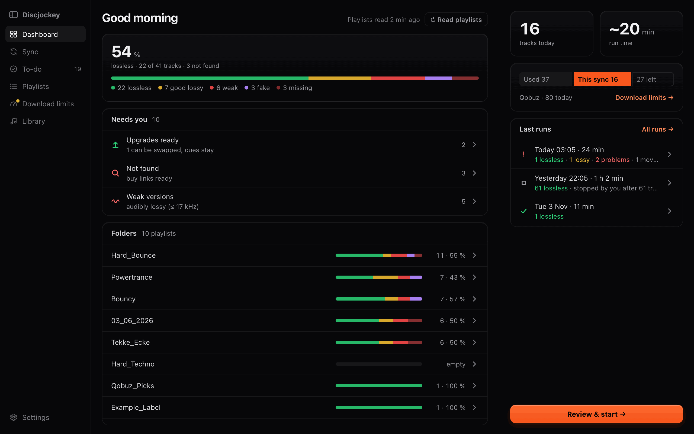
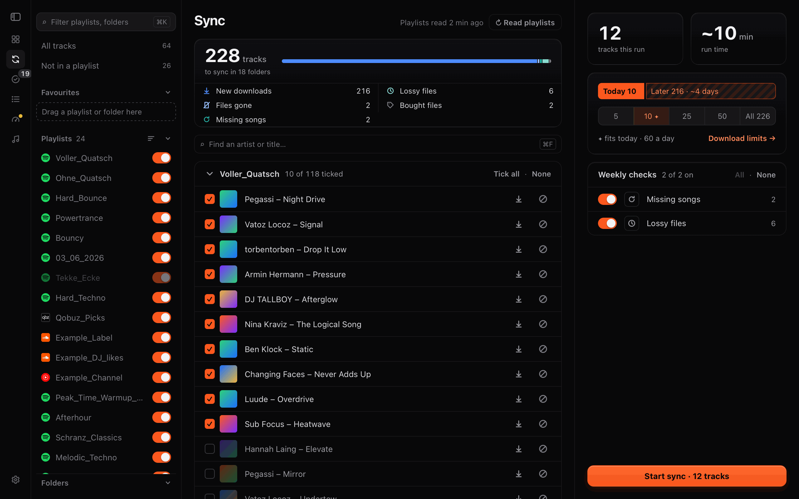

# Discjockey

**Discjockey is a free, open-source Mac app for DJs. It turns your Spotify, Qobuz, SoundCloud and YouTube Music
playlists into a library of verified lossless AIFF files, ready for rekordbox, and keeps that library in step as your
playlists change.**

[**Download for Mac**](https://github.com/TheZwiss/discjockey/releases/latest) &nbsp;·&nbsp; Apple Silicon, macOS 12 or
later &nbsp;·&nbsp; Free, GPL-3.0 &nbsp;·&nbsp; [Manual](docs/manual.md)

You find music in streaming apps, but you play sets from files. Discjockey does the work in between: it finds each
track in the best quality available, checks that a "lossless" file really is lossless, names it `Artist - Title`, puts
it in the folder of its playlist and does it again every time a playlist changes.

## What it does

- **Reads your playlists.** Spotify, Qobuz, SoundCloud (sets and likes) and YouTube Music. Each playlist becomes a
  folder, and a track that sits in several playlists is downloaded once.
- **Shows the plan first.** Before anything downloads you see what is new and what is missing, untick what should wait
  and choose how much to do today.
- **Gets the best version it can.** Qobuz first, saved as 16-bit AIFF. If Qobuz doesn't have a track: the artist's own
  file, then a premium stream (YouTube Premium or SoundCloud Go+), then a free stream.
- **Checks every file.** It measures the spectrum and tells real lossless apart from good lossy, audibly weak and
  "fake lossless" (a lossless file made from a lossy source). Each track shows its quality and where it came from.
- **Upgrades without losing your cues.** When a lossless version of a lossy track turns up, you listen to both and
  swap it in; rekordbox keeps your cue points, loops and beatgrid.
- **Converts your own music to AIFF** (16-bit, 44.1 kHz, the format every CDJ plays) when you ask, with undo.
- **Never deletes a music file.** Anything it replaces goes to `Superseded/`.

## Questions DJs ask

**Does it work with rekordbox?** Yes, rekordbox is what it is built for. You import the `Library` folder into
rekordbox, and the comment column says where each file came from and how good it is. Upgrades and AIFF conversions
update rekordbox's library itself (only while rekordbox is closed) and keep your cues, loops, beatgrid, key, BPM,
ratings and playlists. See [rekordbox](docs/manual.md#rekordbox).

**Is it really lossless?** Only what it can verify. Tracks from Qobuz come as lossless 16-bit AIFF, and every file is
checked and labelled. If a track is only available as a stream, you get a good file, not a lossless one, and Discjockey
says so and looks again later for a lossless version. Without a Qobuz subscription, only an artist's own file can come
in lossless.

**Does it delete my files?** Never. A file that is replaced moves to `Superseded/`, and every replace can be undone.

**Can I use music I already have?** Yes. Add your folders and Discjockey reads them where they are, never downloads a
song you already own and points out duplicates. See [Your existing music](docs/manual.md#your-existing-music).

**Does it need a Qobuz subscription?** For lossless files, yes. Spotify Premium is needed only to sync Spotify
playlists; Qobuz, SoundCloud and YouTube Music playlists don't need it.

**Does it run on Windows or an Intel Mac?** No. It is a Mac app for Apple Silicon (M1 or later), macOS 12 Monterey or
later.

## Install

1. Download `Discjockey-<version>.dmg` from the [latest release](https://github.com/TheZwiss/discjockey/releases/latest),
   open it and drag **Discjockey** onto **Applications**.
2. Open Discjockey. Discjockey isn't registered with Apple, so macOS shows a warning and doesn't open it. Click
   **Done**.
3. Open **System Settings**, then **Privacy & Security**, scroll to the line about Discjockey and click **Open Anyway**.
   Confirm with your password or Touch ID. You do this once for every version you download.

The same steps with screenshots, and what to do if the line is gone, are in the
[manual](docs/manual.md#install-and-open-anyway).

## Quick start

1. Open Discjockey. **Setup** guides you: choose your music folder, sign in to Qobuz (or choose **I don't have Qobuz**)
   and connect Spotify if you use it.
2. Paste the link of a playlist and click **Add to the list**. Add more later; their order decides which folder a
   shared track goes to.
3. Open **Sync**, look at the plan and click **Start sync**.
4. Import the `Library` folder of your music folder into rekordbox.
5. Sync again whenever your playlists change.

More in [One-time setup](docs/manual.md#one-time-setup) and [Daily use](docs/manual.md#daily-use).

## Use with an AI agent

Discjockey also has a command-line interface that an AI agent (Claude, ChatGPT or another) can run for you: see what
needs doing, preview a sync, upgrade tracks. It comes with safety rules an agent must keep. Point your agent at
[AGENTS.md](https://github.com/TheZwiss/discjockey/blob/main/AGENTS.md), and tell it to run
`/Applications/Discjockey.app/Contents/MacOS/Discjockey help --json` to list every command.

## Manual

The [full manual](docs/manual.md) covers everything, section by section:
[Requirements](docs/manual.md#requirements) · [Setup](docs/manual.md#one-time-setup) ·
[Settings](docs/manual.md#settings) · [playlists.txt](docs/manual.md#playliststxt) ·
[Your existing music](docs/manual.md#your-existing-music) · [Daily use](docs/manual.md#daily-use) ·
[The Library page](docs/manual.md#the-library-page) · [Upgrades](docs/manual.md#upgrades) ·
[Making files AIFF](docs/manual.md#making-files-aiff) · [rekordbox](docs/manual.md#rekordbox) ·
[When something breaks](docs/manual.md#when-something-breaks)

## Legal note and account risk

Discjockey is a tool that runs on your Mac. It reads your Spotify, Qobuz, SoundCloud and YouTube Music playlists and
downloads their tracks with your own accounts. It comes with no music and no accounts. You need your own accounts for
the services you use, and you are responsible for following their terms of use. Downloading from Qobuz with streamrip
is against Qobuz's terms of use: the pauses, the daily limit and the automatic pause after repeated failures reduce the
risk that Qobuz notices, but can't remove it. More in [Account risk](docs/manual.md#account-risk).

Spotify, Qobuz, SoundCloud and YouTube names and logos are trademarks of their owners, used only to show where a
playlist comes from; Discjockey isn't affiliated with them.

## Licence and contributing

Free software under the GNU General Public License, version 3 (GPL-3.0); the full text is in [LICENSE](LICENSE).
The programs it includes (ffmpeg, ffprobe, deno, yt-dlp and others) come with their own licences: Settings → This Mac
→ **Show licences** opens them. To run Discjockey from its source code or help with it, see
[CONTRIBUTING.md](CONTRIBUTING.md).
