# Discjockey

Discjockey keeps a lossless DJ library in step with your Spotify and Qobuz playlists. It downloads each
track from Qobuz as lossless 16-bit AIFF, falls back to the best version it can find on
YouTube Music, YouTube or SoundCloud, and never deletes any of your music files.

You need a Mac with Apple Silicon and, for lossless files, a Qobuz subscription. Spotify Premium is only needed
if you sync Spotify playlists (see [Requirements](#requirements)).

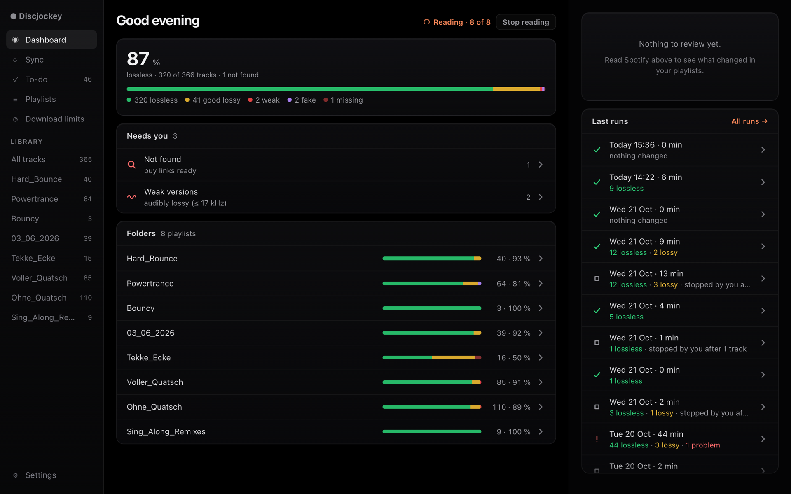

<table>
  <tr>
    <td width="50%" valign="top">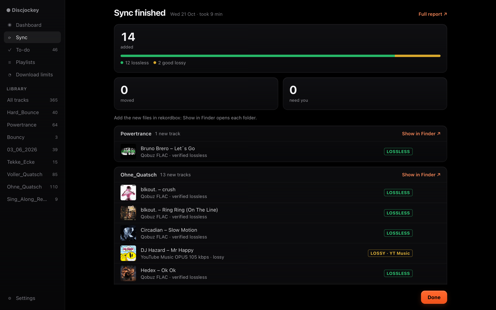<br><sub><b>Sync</b>: what came in, folder by folder</sub></td>
    <td width="50%" valign="top">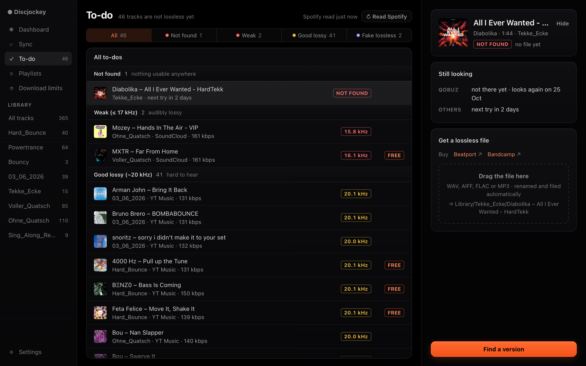<br><sub><b>To-do</b>: everything not lossless yet, with buy links</sub></td>
  </tr>
  <tr>
    <td width="50%" valign="top">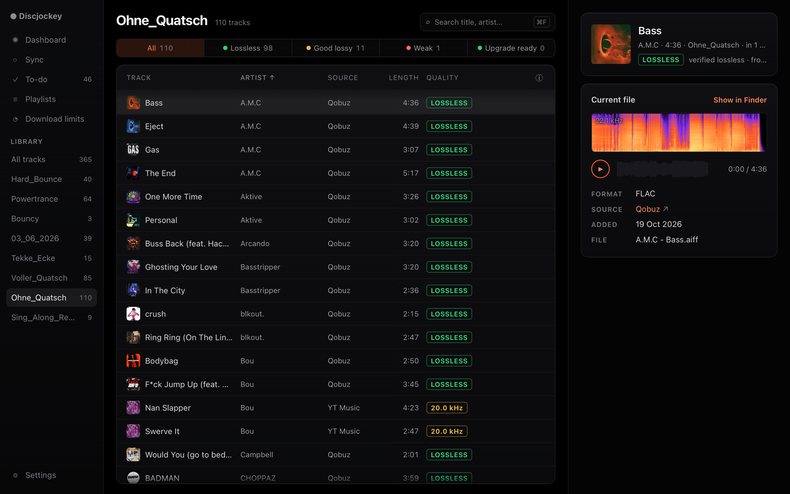<br><sub><b>Library</b>: every track with its quality and spectrum</sub></td>
    <td width="50%" valign="top">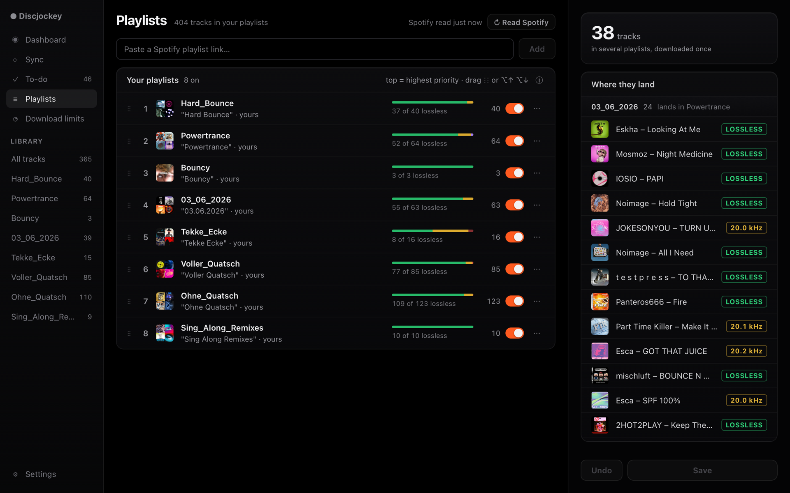<br><sub><b>Playlists</b>: priority order and where shared tracks land</sub></td>
  </tr>
  <tr>
    <td width="50%" valign="top">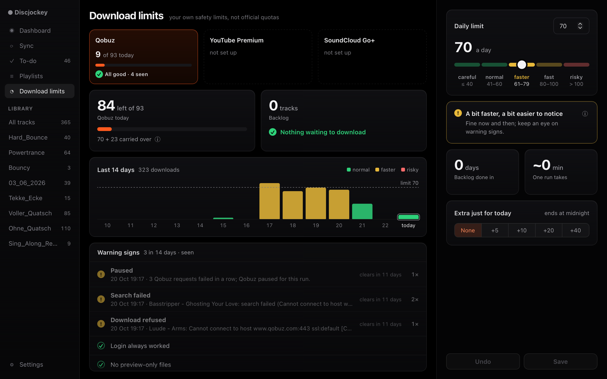<br><sub><b>Download limits</b>: your own safety limits per service</sub></td>
    <td width="50%" valign="top">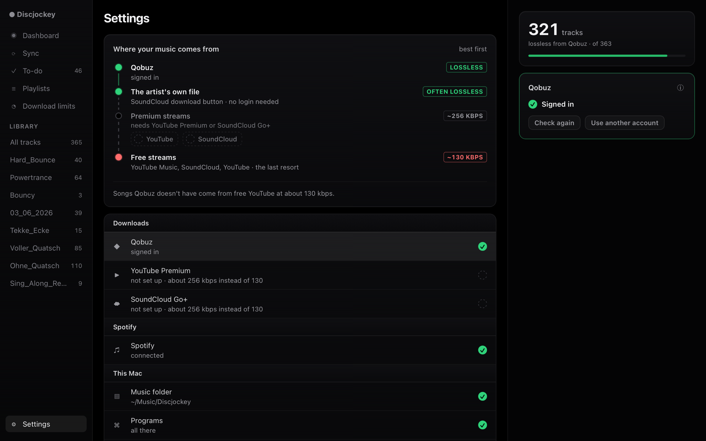<br><sub><b>Settings</b>: where your music comes from, best first</sub></td>
  </tr>
</table>

## Download

Download `Discjockey-<version>.dmg` (for example `Discjockey-1.0.0.dmg`) from the
[latest release](https://github.com/TheZwiss/discjockey/releases/latest). It is free.

## Requirements

- **A Mac with Apple Silicon** (M1 or later) and **macOS 12 Monterey** or later.
- **Spotify Premium, if you sync Spotify playlists.** Setup asks you to create a small Spotify "app" of your own,
  and Spotify only allows that with a Premium account. Discjockey syncs your own playlists and collaborative ones
  (a Spotify rule). If you only use Qobuz playlists, skip Spotify in Setup.
- **A Qobuz subscription** for lossless files: a paid plan that plays full tracks. Without Qobuz, choose
  **I don't have Qobuz** in Setup. Discjockey then gets every track from YouTube Music, YouTube or SoundCloud,
  and nothing comes in lossless, except an artist's own file when there is one.
- **Optional:** YouTube Premium or SoundCloud Go+ for better streams when Qobuz doesn't have a track.

## Legal note

Discjockey is a tool that runs on your Mac. It reads your Spotify and Qobuz playlists and downloads their tracks with your own
accounts: Qobuz first, then YouTube Music, YouTube or SoundCloud. It comes with no music and no accounts. You need
your own accounts for the services you use, and you are responsible for following the terms of use of Spotify, Qobuz and
every other service you use with it. Read [Account risk](#account-risk) before your first sync.

## Install and "Open Anyway"

Discjockey isn't registered with Apple, so the first time macOS asks you to confirm that you want to open it. You do
this once for every version you download.

1. Open the `.dmg` you downloaded and drag **Discjockey** onto **Applications**.
2. Open Discjockey from your Applications folder. macOS doesn't open it and shows a warning instead.

   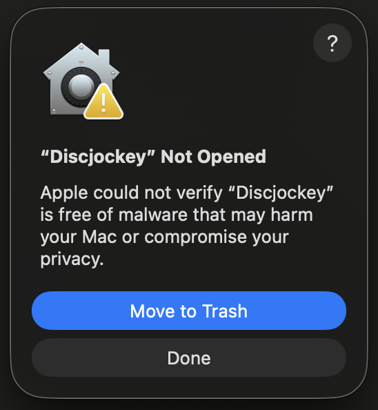

3. Click **Done** (the button that isn't **Move to Trash**).
4. Open **System Settings** and click **Privacy & Security** (on macOS 12: **System Preferences**, then
   **Security & Privacy**, then **General**). Near the bottom is a line about Discjockey. It only shows after you
   tried to open Discjockey, and only for about an hour; if it's gone, open Discjockey once more.

   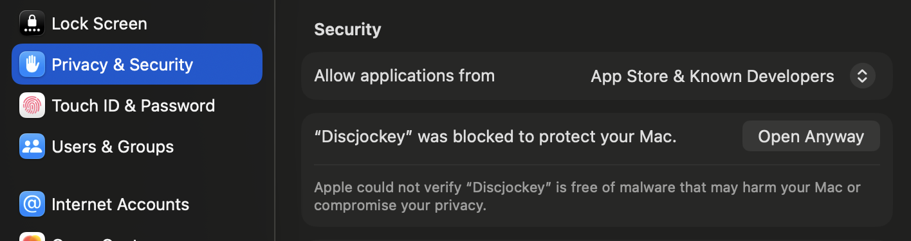

5. Click **Open Anyway** on that line.
6. The warning shows once more. Click **Open Anyway** (on older macOS: **Open**), then confirm with your Mac's
   password or Touch ID.

   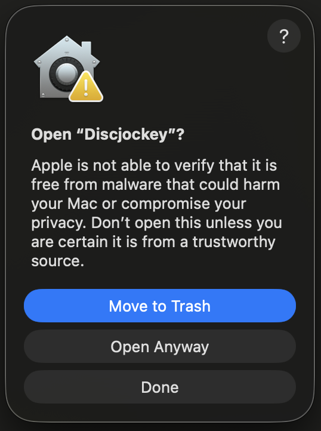 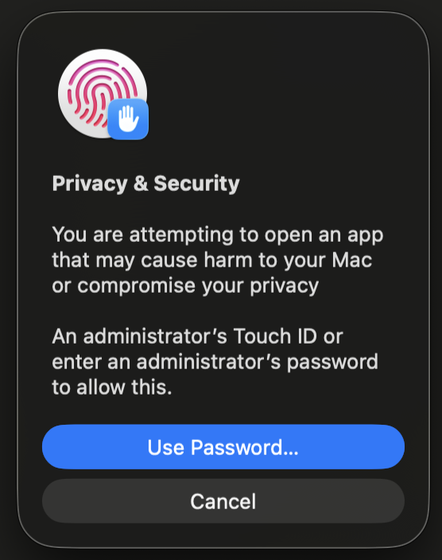

Discjockey opens and starts Setup.

## Updates

Discjockey looks for a newer version once a day: it asks GitHub for the latest release (nothing about you or your
library is sent). When one is out, a line under its name in the sidebar says so; click it to open the download page.

To update, download the new `.dmg` and drag Discjockey onto Applications again, replacing the old one. Your music,
logins and settings stay where they are. Then confirm it once with "Open Anyway", as above.

## One-time setup

The first time you open Discjockey, it shows **Setup**, a short guide in up to six steps.
A row of steps at the top shows where you are; **Continue** lights up once a step is done,
and a line next to it says what is still missing. **Finish later** closes the guide; it comes
back by itself the next time while a needed step is still open.

1. **Music folder:** where Discjockey keeps your library. Choose **A new folder** (the
   suggestion is `Discjockey` in your Music folder, `~/Music/Discjockey`) or **A folder I
   already have**, pick it with **Choose…**, then click **Use this folder**. A folder that
   already holds a Discjockey library is used as it is. If other files are in it, they stay
   where they are and Discjockey adds its folders next to them (it asks first). Later, point
   rekordbox at its `Library` folder.
2. **Your existing music** (optional): click **Add folder…** for each folder that already holds music you
   have, and Discjockey starts reading it. **Continue** works with or without a folder.
   See [Your existing music](#your-existing-music).
3. **Programs:** Setup skips this step unless a program Discjockey needs is missing. Then it
   shows the line to paste into Terminal; click **Check again**.
4. **Spotify:** create a free "app" in Spotify's developer dashboard (the step lists what to
   click, with a **Copy** button for the Redirect URI), paste its Client ID and click
   **Connect**. Your browser opens to log in to Spotify. Discjockey only reads your playlists.
   If you don't use Spotify playlists, choose **I don't use Spotify**; you can connect it later in Settings.
5. **Downloads:** sign in to Qobuz, or choose **I don't have Qobuz**. YouTube Premium and
   SoundCloud Go+ are optional; see [Settings](#settings) for how their logins work. Beside
   the logins, "Where your music comes from" lights up as each one works.
6. **First playlist:** paste the link of a Spotify or Qobuz playlist and click **Add to the list**.
   Add more and change their order later on the Playlists page. **Finish** opens the Sync page.

Everything in Setup can be changed later in **Settings**. Once setup is done, a link to a
setup step opens the same thing in Settings.

## Settings

**Settings** (bottom left in the window) lists every login and option in one place. Click a
line to see it on the right.

- **Where your music comes from**, at the top, shows the order Discjockey tries for each song,
  best first: **Qobuz** (lossless), **the artist's own file** (SoundCloud's download button,
  often lossless), **premium streams** through YouTube Premium or SoundCloud Go+ (about 256
  kbps) and, as the last resort, **free streams** (about 130 kbps). Each line lights up when
  it works, and the note under it says where the songs Qobuz doesn't have come from.
- **Qobuz:** enter your Qobuz e-mail and password and click **Sign in**; Discjockey tests the
  login with one search. They are stored only on this Mac. If you log in to Qobuz with
  **Google, Apple or Facebook**, give your Qobuz account a password once first: open
  https://www.qobuz.com/signin/forget-password, enter your account's e-mail, open the e-mail
  from Qobuz and choose a password. Your Google, Apple or Facebook sign-in keeps working, and
  Discjockey signs in with that e-mail and password.
- **YouTube Premium and SoundCloud Go+:** Discjockey uses the login in your web browser. If it
  finds one (in Chrome, Brave, Edge, Firefox or Safari, for each Chrome profile separately),
  it says so: click **Use this login**, and Discjockey checks one song. If there is none, click
  **Sign in**: the sign-in page opens in your browser, and Discjockey notices the login by
  itself (it waits up to 10 minutes; **Cancel** stops waiting). **Another browser** picks a
  different browser or profile. The first time, macOS asks about "Chrome Safe Storage" (or
  your browser's name): click **Always Allow**. Safari's logins can only be read when
  Discjockey has Full Disk Access (System Settings, Privacy & Security); the card has a button
  that opens that page.
- **Check again** tests a saved login again; **Sign out** forgets it.
- **Spotify:** shows which account is connected, with **Connect again** and **Sign out**.
  The Spotify app's Client ID can be changed under "Spotify app (Client ID)". If you skipped Spotify in Setup,
  connect it here when you want to use Spotify playlists.
- **Watched folders:** the folders Discjockey reads for music you already have, and the import's progress
  (see [Your existing music](#your-existing-music)).
- **This Mac:** the **Music folder** (**Change…** picks another one and closes Discjockey so it
  starts again with it; **Show in Finder** opens it), the programs Discjockey uses and its download
  tools: yt-dlp shows its version and "built in" (it came with Discjockey) or "updated". **Update
  download tools** gets the newest yt-dlp, checks it, and asks you to open Discjockey again;
  **Go back to …** undoes the last update. **About Discjockey** shows the version and whether it is up to date;
  **Show licences** opens the licences of everything Discjockey includes. Then the reports folder.

## Where things live

- **Your music folder** (`~/Music/Discjockey`, or the one you chose) holds your library:
  `Library/`, `Superseded/`, `Upgrades ready/` and `playlists.txt`. It also has a hidden
  `.discjockey/` folder with Discjockey's notes about your library: `library.db` (Discjockey's records of your
  tracks and where their files are), `state.v1.json` (a copy of the old records, kept after the update below), the
  `reports/` and `not_lossless.md`. It can be on an external drive.
- **Updating from an earlier version:** the first time a new Discjockey opens your library, it says
  "Updating Discjockey's records…" and turns the old records into `library.db`. This happens once and can take a
  minute. Your music files are not touched, and `state.v1.json` stays as a copy of the old records.
- **Files you move by hand:** you can move or rename files inside `Library/` in Finder. Discjockey looks at
  `Library/` when the window opens or comes back to the front, and before every sync, and finds the files where
  they are now. It doesn't download them again.
- **`~/Library/Application Support/Discjockey/`** holds what belongs to this Mac: your logins,
  the settings (`settings.json`), `config.json`, which remembers where your music folder is, and `tools/`, where
  **Update download tools** keeps a newer yt-dlp (the one that came with Discjockey stays inside it).
- **Moving the library:** move the folder in Finder. If Discjockey is open, use Settings, Music
  folder, **Change…**. If it was closed, it opens on the "isn't there" screen; click **Choose another…**
  there and pick the folder at its new place.
- **If the music folder isn't there** (for example, the external drive is unplugged), the window
  says so. Connect the drive and click **Try again**, or click **Choose another…**.

## playlists.txt

`playlists.txt` in your music folder holds your playlists, one per line. The **Playlists** page in the window
changes it for you; you can also edit it in any text editor:

```
Hard_Bounce = https://open.spotify.com/playlist/...
Powertrance = https://open.qobuz.com/playlist/...
```

- The name on the left is the folder in `Library/`.
- **Links:** each line takes a Spotify or a Qobuz playlist link. For Qobuz, use the link from the Qobuz player
  (`open.qobuz.com/playlist/...`, `play.qobuz.com/playlist/...` or `listen.qobuz.com/playlist/...`) or from the Qobuz store
  (`www.qobuz.com/gb-en/playlists/.../...`). In the app, **Share**, then **Copy link** gives you one.
- **Priority:** the line further up wins. A track that is in several playlists goes into the
  folder of the first one.
- **Switching a playlist off:** put `#` at the start of its line. Its tracks stay where they
  are; nothing is moved or deleted.
- **Renaming a folder:** change the name on the left. Files already in `Library/` stay where they are, and new
  downloads go into the new folder. To move the files you have, see [Tidying up files](#tidying-up-files).
- **Changing the order:** a track that is in several playlists stays in the folder it is in now. Only new
  downloads follow the new order. [Tidying up files](#tidying-up-files) moves the files you have to where the order puts them.
- **Spotify playlists** must be your own or collaborative ones (a Spotify rule). Spotify only has to be connected
  when a line uses it.
- **Qobuz playlists** must be public or your own. Qobuz has to be set up (signed in) when a line uses it. A track
  in a Qobuz playlist is downloaded as that exact Qobuz track, with no search. Reading a Qobuz playlist does not
  count against the daily [Qobuz limit](#daily-use); only downloads do.

## Your existing music

Music you already have, outside `Library/`, can be part of Discjockey too: it shows in **Library**, a playlist song
you already own isn't downloaded again, and duplicates are pointed out. Discjockey reads these files where they are.
**Nothing is copied, moved, renamed or re-tagged** by the import.

**Watched folders** (Settings, or Setup's "Your existing music"): click **Add folder…** and choose a folder, on this
Mac or on a drive. Your `Library/` is always watched and is listed first.

- **Adding:** a folder inside your music folder or inside another watched folder is refused (it is watched already),
  and so is one that holds your music folder. A folder that holds other watched folders takes them over, and what
  Discjockey already knows about their files stays.
- **Offline:** a folder on a drive that isn't connected shows "Offline: connect the drive". Its songs stay in
  Library; they just can't be played or moved until the drive is back, and nothing is forgotten.
- **Folder not found:** a folder that was moved, renamed or deleted (its drive is there) shows "Folder not found:
  moved, renamed or deleted? Put it back or remove it here." It waits the same way. A single song whose file was
  deleted inside a folder that is there says "This file isn't there any more." until the next scan.
- **Removing:** **Remove** asks first. Discjockey forgets the folder's files; the files stay where they are. If a
  song from your playlists had its only copy there, the dialog says so, and the next sync downloads it again.

**The import** starts by itself after **Add folder…** and when the window opens with files waiting. Each folder shows
"Importing · {n} waiting" and Settings shows the live phase:

1. *Looking for music files.*
2. *Reading tags*, for every file: its artist, title, length and format. A file with no tags is named from its file
   name. Each file becomes a track in Library with the quality its format gives for now ("sound not checked yet").
3. *Checking the sound*, for every file: the same quality check as for downloads. This takes the longest, which is why
   the tags come first: a sync after a stopped import already knows which songs you have.
4. *Linking to your playlists:* a playlist song you already own is linked to your file instead of being downloaded.
   If your playlists can't be read just then, this waits for the next sync.

- **Stop** (on the import's card) stops the import. "Import stopped with {n} files to go. It carries on
  where it stopped." The import doesn't restart by itself during the session; **Continue import**, or opening the
  window again, carries on exactly where it stopped. After a crash or a power cut it picks up the same way.
- **Couldn't read:** files that can't be read are listed with the reason and tried again at the next import.
- While it runs, actions that change your files (a sync, a tidy-up) say "Discjockey is importing your music…" and
  don't start. Stop the import in Settings → Watched folders, then go ahead; it carries on later.
- The console never imports: it only says how many files wait and how many songs need your answer, and asks you to
  open the window.

**Two new groups on the To-do page** (only for what your own music raises):

- **Is this the same song?** A file of yours might be a playlist song: same title with another artist, or the same
  artist and title with a different length. Until you answer, Discjockey doesn't download that song. **Yes, it's the
  same song** links your file to it; **No, keep them apart** lets the next sync download it.
- **Duplicates:** the same song more than once among your files. **Keep both** (**Keep all**) leaves them; **Move to
  Superseded** on a file moves it to `Superseded/`. Nothing is deleted. The cards are labelled by the folder each file
  is in.

Your own music appears on the To-do page only here and under **Upgrade ready**, never as "weak" or "fake" lossless:
the Library shows each file's quality.

**Upgrade checks are spread over runs.** The first look on Qobuz for a better version of each imported lossy file
runs at most 25 per sync, and never more than half of what is left of today's Qobuz allowance, so a big import doesn't
use up the downloads of your playlists. The Sync page says how many wait for a later run.

## Tidying up files

A sync only adds files; it never moves one that is already in `Library/`. Files move only when you ask for it on the
**Playlists** page. Nothing is deleted, and every move can be undone there.

- **When you save a change that would put files in a different folder,** Discjockey asks first. It tells you how many
  files would sit in a different folder. **Save and move the files** moves them right away.
  **Save, leave files where they are** only saves the list: the files stay, and Discjockey treats them as placed by you.
- **The Tidy up files button** shows what would move before anything does. Each file has a tick, and you can untick
  what should stay. Click the **Move … files** button to go ahead. Files that can't be moved are listed with the reason: the drive is
  offline, a file with that name is already in the folder, the file isn't where Discjockey last saw it, or the system
  refused. The rest still move.
- **"You put these here"** lists the files you chose to leave where they are (or put there yourself). They are not
  ticked, so a tidy-up leaves them alone. Click **Put these in playlist order too** to tick them all. A file a
  tidy-up moves follows the playlist order from then on.
- **Renaming a folder on disk:** when you rename a playlist, **Rename the folder on disk too** moves the whole folder
  in one step instead of file by file. It is not offered if a folder with the new name is already in your Library, or
  if the old folder still belongs to another playlist.
- **Undo:** **Undo** on the Playlists page puts a batch of moves back. Undoing a folder rename puts the folder and the
  playlist name back. If the playlist has been renamed again since, nothing moves. A file that was moved or changed
  since, or whose old place is taken by another file, is skipped and listed.
- **If a tidy-up is stopped halfway,** Discjockey finishes the file it is moving and stops there. Files it hadn't
  reached stay where they are. The **Tidy up files** button offers them again, and you can undo what did move. If
  the Mac loses power instead, the file being moved is finished or put back the next time Discjockey starts, and it
  tells you so.
- **After a sync in the console,** Discjockey says how many files are not where the playlist order puts them. It
  counts only files a tidy-up would tick by default, so files you chose to leave don't nag you. The console never
  moves files.

Discjockey never renames a file when it moves it. rekordbox may show moved tracks as missing; its Relocate finds
them again by file name (see [rekordbox](#rekordbox)).

## Daily use

Open Discjockey and click **Sync** in the sidebar. Before anything changes, it shows the plan:
new downloads, bought files to add, and tracks no longer in any playlist. Untick what should wait, then click
**Start sync**.

- A run of 60 downloads takes 1 to 2 hours, because Discjockey waits between Qobuz downloads.
  The Mac stays awake while it runs.
- **Stopping:** **Stop safely** stops after the current track. Nothing is left half done, and the next sync
  continues where this one stopped.

**Qobuz limit.** Discjockey downloads at most 60 tracks a day from Qobuz. Up to a third of
yesterday's unused amount is added on top. The **Download limits** page changes the daily limit and can allow some
extra downloads for today only. After 3 failed Qobuz requests in a row, Qobuz pauses for the rest of the run, and
those tracks are tried again next time.

### Listening through a list

Press ▶ on a track's cover in **Library** (or in its details, or a to-do's details) and Discjockey plays that track,
then the rest of the list as you see it: the folder with its filter, search and sort, or the to-do list. Only tracks
that have a file are played. Changing the filter later doesn't change what plays.

- A bar along the bottom of the window shows what plays, wherever you go: ⏮ previous, ⏯ play/pause, ⏭ next. The thin
  orange line above it is the position: point at it to see the time, click or drag to jump.
- ⏮ starts the track again after its first 3 seconds; in the first 3 seconds it goes back one track.
- ⤮ **Shuffle** plays the rest of the list in random order; off goes back to the list's order.
- After the last track it stops at "End of …"; ▶ plays the list again from the top.
- The track's name takes you back to its list with the playing track selected.
- ⌄ **Hide player** folds the bar into a **Now playing** row in the sidebar (⏯ still works there); ⌃ or the title
  brings it back. × **Stop** ends it.
- Keys: **Space** plays or pauses, **⌘→** next, **⌘←** previous (not while you type in a field).
- If a file can't be played, the bar says so and waits; ⏭ goes on.

## Folders

- `Library/<Folder>/` holds lossless tracks (verified) and files you bought.
- `Library/<Folder>/not_lossless/` holds the best available version when Qobuz doesn't have
  the track. These are lossy or "fake lossless" (a lossless file made from a lossy source).
- `Superseded/<Folder>/` holds files that were replaced: the old lossy file when you add a
  bought copy or add a lossless version as a new file, and the backup of a swapped file
  (its name ends in "(lossy)"). A bought file or a better version goes into the folder the current file is in,
  and the old file goes to the same folder under `Superseded/`. Nothing here is ever deleted by Discjockey. Once rekordbox no
  longer uses a file there, you can delete it by hand.
- `Upgrades ready/<Folder>/` holds lossless versions Discjockey found for your lossy tracks,
  waiting for you to decide (see [Upgrades](#upgrades)). It sits next to `Library/`, so rekordbox doesn't
  see these files, but you can listen to them in Finder.

## Reports and not_lossless.md

After every run, Discjockey writes a report to `.discjockey/reports/` in your music folder and shows a short
summary. Each section of the report says what happened: new lossless tracks, new tracks
that are not lossless, fake lossless, lossless versions found and waiting for you, moved, no
longer in any playlist, not found anywhere, waiting for the next run (the Qobuz limit was
reached), and errors (tried again next run).

`.discjockey/not_lossless.md` lists every track that isn't lossless yet, with buy links.
If you buy one, save it under the exact name shown (as `.wav` or `.aiff`) in its folder. The
next run picks it up and takes the place of the lossy copy. When a lossless version is
waiting for a track, the list says so.

## Upgrades

Once a week, Discjockey looks on Qobuz for a lossless version of each track in `not_lossless/`.
When it finds one, it doesn't replace anything. It **parks** the new file in
`Upgrades ready/<Folder>/` and checks whether the two versions line up exactly (same edit,
same start). The track then shows on the **To-do** page as "Upgrade ready". For music
you imported from your own folders, the first check of each file is spread over several runs (see
[Your existing music](#your-existing-music)).

**Tip: quit rekordbox first.** For each waiting track you see the file you have now (**Now**) and the new
one (**New**), side by side, and whether they line up. A small player lets you listen to
both in the window before you choose. Then you choose:

- **Swap the files** (only offered when the versions line up). The lossless audio goes into your
  existing file, so rekordbox keeps the track with your cue points, loops and beatgrid. If
  the new version starts a few milliseconds earlier or later, Discjockey shifts it so your cues
  still sit on the same beat. Before anything is overwritten, a checked copy of your old file
  is saved in `Superseded/<Folder>/` with "(lossy)" in its name. If the file was in
  `not_lossless/`, it moves up into the folder itself (unless a file with that name is already
  there). In rekordbox, if the track then shows as missing, use Auto Relocate (the search for
  missing files in `Library/`): it finds the file by its name, with cues and beatgrid in place.
  The track already plays the lossless audio. Optional: right-click → **Reload Tag** so the
  comment shows the new source, and analyse it again so the waveform shows the full sound
  (lock the beatgrid first if you adjusted it by hand).
- **Add as new file.** Your old file moves to `Superseded/` first, then the lossless
  file goes into the folder under the correct name, `<Artist - Title>.aiff` (files in
  `Library/` always carry the correct name; only a file that is in the way gets an ID added).
  In rekordbox, if the track shows as missing, use Auto Relocate: it finds the new file by
  its name and links your old track to it. The cues and beatgrid belong to the old edit, so
  analyse the track again and set the cues again. Discjockey reminds you: the run report and
  the To-do page ("Check in rekordbox") list the track until you mark it as done. Use
  this when the versions don't line up (for example a different edit).
- **Discard.** The parked file is deleted and Discjockey never offers that file again.
- Or leave it: nothing changes, and it waits for next time.

A swap is safe to interrupt. If Discjockey or the Mac stops in the middle of one, Discjockey finishes it or puts
your old file back the next time it works on your library.

`Upgrades ready/` only holds Discjockey's own downloads. If you delete a file there by hand,
Discjockey simply forgets it. If you buy the track or it gets downloaded again, the waiting
version is removed because it's no longer needed.

## rekordbox

- Import the folders in `Library/` (inside your music folder) into rekordbox.
- The comment column shows where each file came from and how good it is.
- Discjockey doesn't move your files when you change the playlist order or a folder name, so rekordbox keeps
  finding them. If you move a file yourself (in Finder, or with **Tidy up**), rekordbox may show it as missing. Use
  rekordbox's Relocate to point it at the new place. Discjockey never renames a file when it moves it, so Relocate
  finds moved files by their file name. Auto Relocate searches only the folders set for it in rekordbox's
  settings: add your music folder there once, and it finds every moved file on its own.
- When you add a bought copy, the old lossy file moves to `Superseded/`, and rekordbox's entry
  (with your cue points) goes with it. The bought file is a new entry: set the cues again,
  then remove the old entry.
- Lossless versions from Qobuz never replace a file on their own: you decide on the To-do page
  (see [Upgrades](#upgrades)). A swap keeps your cue points; adding as a new file works like a bought copy.

## When something breaks

- **Every YouTube download fails with "403":** open Settings, This Mac, Programs and click **Update download tools**,
  then open Discjockey again.
- **Qobuz login fails:** open Settings, click Qobuz and sign in again. If it still fails, Qobuz may have changed
  something that a newer Discjockey fixes: Qobuz's part is updated with Discjockey itself.
- **Spotify says a playlist is not accessible:** it has to be your own playlist or a
  collaborative one.
- **Qobuz doesn't show a playlist:** it has to be public or one of yours. Check the link, or put `#` in front of
  the line.
- **"Another Discjockey run is still going":** wait until the other run has finished.

## Account risk

Downloading with streamrip is against Qobuz's terms of use. The pauses, the daily limit and
the automatic pause after repeated failures reduce the risk that Qobuz notices, but can't
remove it.

## Licence

Discjockey is free software under the GNU General Public License, version 3 (GPL-3.0); the full text is in
[LICENSE](LICENSE). The programs it includes (ffmpeg, ffprobe, deno, yt-dlp and others) come with their own
licences: Settings → This Mac → **Show licences** opens them.

People who want to run Discjockey from its source code, or help with it, find the notes in
[CONTRIBUTING.md](CONTRIBUTING.md). That is also where the Terminal version is described.
