# Hub design language

Living document. **Read it first for any hub UI work.** It is the practical digest of the spec
`docs/2026-10-20-hub-design-system-design.md` (cited as §N below). The spec stays the authority and holds the reasons;
this doc says what to do. Update it in the same commit as any change to `tokens.css`, a frame or a block.

What you need, in this order:
1. This doc (the rules, each with a Do and a Don't).
2. The gallery, `#/dev/gallery` in fake mode (`cd hub-ui && npm run dev`): every block in every state, each section
   headed by the rule it carries. It is the catalogue; copy from it.
3. The Sync page, the reference (last section), and its shots `hub-ui/screenshots/sync-*@<size>.png`.
4. For page work: `docs/hub-page-brief.md`, the playbook.

Screenshots sit in `docs/hub-design-language/`. Do shots come from the gallery and the redesigned Sync page. Don't
shots come from pages phase 2 hasn't redesigned yet (they still break the rules) and from the space mockup. Task 1's
`hub-ui/screenshots/before/` set no longer exists, so where no real example of a break is left, the caption says so.

---

## 1. Space (§3)

**Window sizes.** Designed at 1280 × 800, must work from 1100 × 700 up to 2560 × 1440. Check all three.

### Rule: more space shows more, never bigger
Type, controls, cards and buttons have fixed sizes. Extra width shows optional columns; extra height shows more rows.
The panel never takes free width.

| Do | Don't |
|---|---|
| 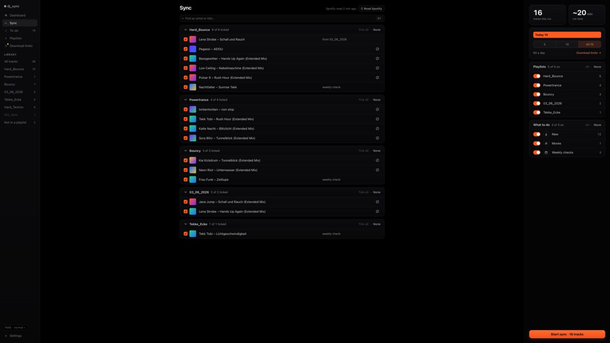 | 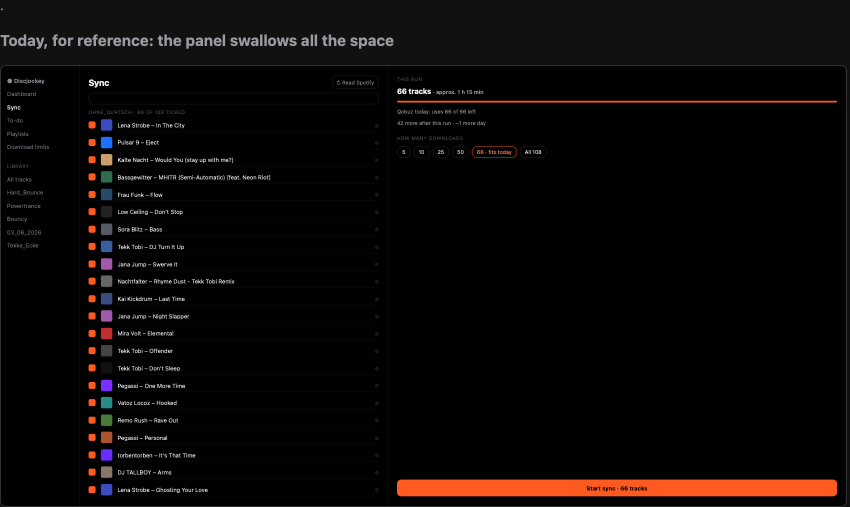 |
| Sync at 2560 × 1440: rows stop at 900 px and centre, the panel stays 360 px, the button keeps its size. | The old Sync (`docs/hub-mockups/design-system/space-rule.html`, "Today"): the panel takes all free width and its button grows with it. |

### Rule: exactly two page frames
Every page uses one, from `hub-ui/src/lib/frames`:
- **`ListPanelFrame`** (snippets `main`, `panel`; `emptyPanel` text; `wide`): sidebar 168 · list area · panel docked
  right, **360 px**, **320 px** below 1240 px window width (one step, never fluid). List content grows to **900 px**
  (`wide`, Library's table: **1200 px**), then centres.
- **`ColumnFrame`** (snippets `content`, `foot`): content up to **900 px**, centred. For the running sync, the end
  screen, Settings, Setup.

A child that scrolls inside itself (Library's table) marks its root `data-scrolls-itself`; the frame then gives it
exactly the scroller's height instead of growing around it. Only that child gives way: everything above it keeps its
natural height (a `Segmented` clips its overflow and would otherwise shrink to a sliver).

### Rule: the frame is an L, the foot belongs to it
The window's chrome is one **L-shaped frame**: the sidebar and, while something goes on, the **foot** (`lib/shell/Foot.svelte`,
44 px, `--activity-h`, full window width under sidebar and page). Both are one material, `--sidebar-bg`, painted once
by `App.svelte` behind them, so they never meet in a seam; the page sits inside on black. Only the page's edge has a
line: the sidebar's right border, continued along the page's lower edge (1 px `--surface-line` from `--sidebar-w` to the
right). Chrome joins this frame; it never floats over the page or reserves a strip of its own.
- **The foot holds what goes on:** the player bar while a list plays (a queue, plan now-playing), the sync's status
  while the hub's own sync runs (not on Sync itself), or both in one bar (the sync's short form at the bar's right end).
  No foot when neither.
- **The player bar:** grid `minmax(0,1fr) auto minmax(0,1fr)` with the same padding on both sides, so ⏯ sits exactly
  on the window's centre; left the 28 px cover, the title and "Artist · list" (a link back to the list, the playing
  track selected), starting at the sidebar items' inset (18 px); middle the times (fixed 44 px each, so nothing moves)
  around ⏮ ⏯ ⏭; right [sync] · ⤮ · | · ⌄ Hide player · × Stop, the Stop glyph 18 px from the window's edge.
- **The position is the page's lower edge:** the played part is 2 px of `--accent` on that line; under the pointer it
  thickens to 4 px with a knob and the time under the pointer; click or drag seeks, 1:1 with the pointer (`scrub`).
  The hit area is 10 px, centred on the line. While a track loads, no fill.
- **Hide folds the bar into the sidebar:** a **Now playing** row above Settings (`NowPlayingRow.svelte`: the "Library"
  label's style, a 32 px row with a 22 px `PlayButton`, the title, a 22 px ⌃ `Button icon xs`, the position as a 2 px
  line under the title). Show (⌃ or the title) unfolds it again. The folders above give way.
- Disabled controls are grey, never removed (a list of one: ⤮ ⏮ ⏭ grey; the end of the list: ⏭ grey).

| Do | Don't |
|---|---|
| Gallery, Foot (`base-gallery-foot`): every state of the bar on its L, and the row. Library playing (`library-now-playing`), Dashboard with a sync (`base-shell-foot-sync`), hidden (`library-now-playing-hidden`). | The two forms the user rejected for now playing (mockup rounds 1–2): a floating pill over a reserved strip under the page (takes space and still looks detached), and a player crammed into the sidebar (too tight). |

### Rule: a panel is head, fill, foot
**`Panel`** (`lib/frames/Panel.svelte`, snippets `head`, `fill`, `after`, `foot`):
- `head` and `after` keep their natural height and never shrink. `fill` holds the one list of unknown length.
- `fill` grows to its list's height, not past it; the spare height sits above the foot. A cut list ends on whole rows
  plus a **half-row peek** under the end fade, so it never reads as complete. The minimum and the peek come from the
  list's own min-height (`floor` in `growSpare`); a list whose rows differ in height (a `ListRow wrap`, section
  heads) is cut by its rows' measured tops, so the peek still lands inside a row. **One grow group per Panel**: the spacer holds one group's spare (dev
  mode warns about a second).
- Scroll ends fade (`edgeFade` action, `--edge-fade` 16 px to `--edge-fade-to`); when even `fill`'s 3-row minimum
  doesn't fit, the whole body scrolls and its cut fades over a row's height (`--h-row`). `edgeFade` follows added and
  removed children one by one; a child that later switches to or from `display: contents` isn't noticed.
- `foot` holds the page's main action and **never scrolls away**.
- **Every list that grows over time is anchored and scrolls in place** (playlists, runs, folders): a `ToggleGroup
  grow` or a `Surface grow` in `fill`, or a `Surface grow` as the last item of a page frame's list, which then keeps
  the list area at the window's height (`data-scrolls-itself`). Lists that grow are never stacked one above another
  in a scrolling column, where a long one pushes the next off screen. A list with a fixed maximum (Dashboard's Needs
  you, three rows) keeps its natural height.

| Do | Don't |
|---|---|
| 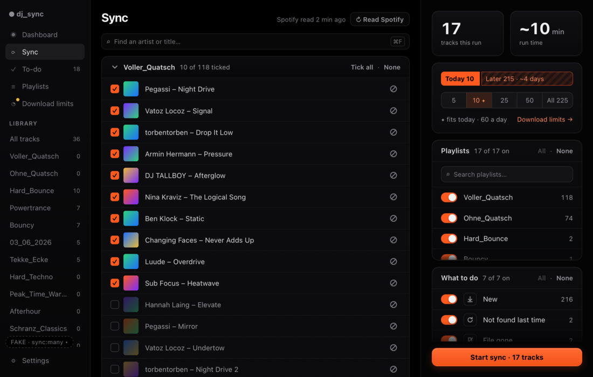 | No old shot is left. The break was a panel whose button scrolled out of view at 1100 × 700; the checker now fails it (`clipped`). |
| Sync at 1100 × 700, 17 playlists: Playlists scrolls inside with a peek, What to do follows, Start sync stays in view. | |

### Rule: optional columns by container query, never horizontal scroll
Optional columns appear through `@container` on the list, never window media queries (Sync's why column from 680 px
list width). Nothing ever scrolls sideways: long text ends in "…" with the full text in `title`.

| Do | Don't |
|---|---|
| 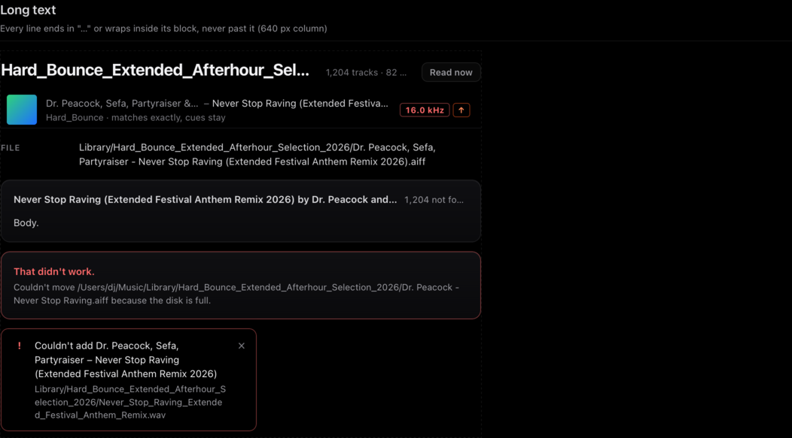 | No old shot is left. The checker fails any sideways scroll (`overflow`). |
| Gallery, Long text: every long name ends in "…", the right side keeps its place. | |

---

## 2. Visual grammar: show before tell (§4)

### Rule: every quantity is a number plus a visual
A bar, ring, day bar or a count column. Every state is colour plus shape (badge, dot or icon), never colour alone,
never text alone.

| Do | Don't |
|---|---|
| 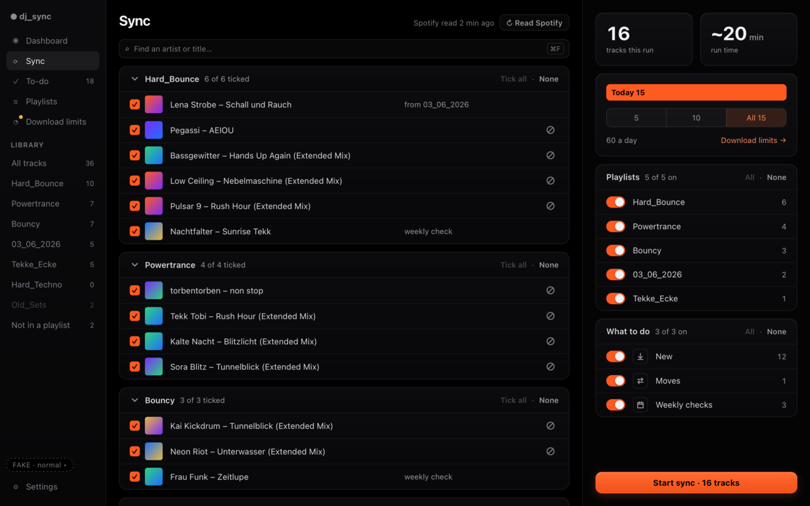 | 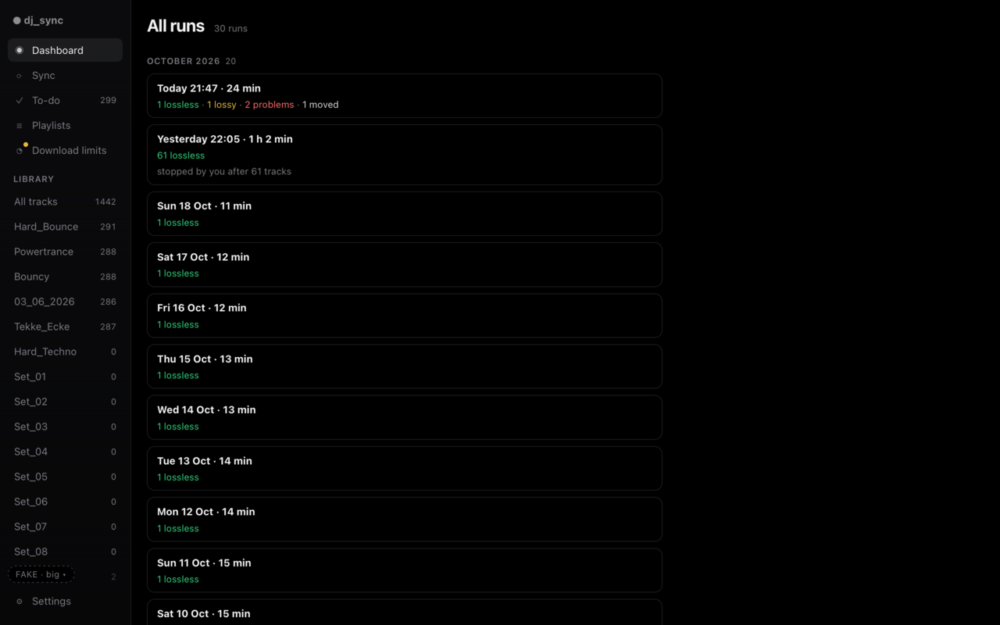 |
| Sync: count and run time as `StatCard`s, today vs later as a `DayBar`, playlists with their counts in a column. | All runs before its redesign: each run is lines of small text; nothing to see at a glance. |

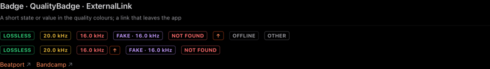
*Do: gallery, Badge · QualityBadge. A state is a coloured badge with a word, never colour alone.*

### Rule: everything sits in a container
A `Surface` card, list or table. On the bare background only: the page title and its status line, section labels,
and a one-line `Hint` directly under the control it explains.

| Do | Don't |
|---|---|
| 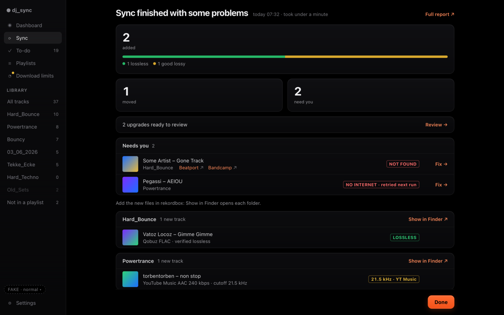 | 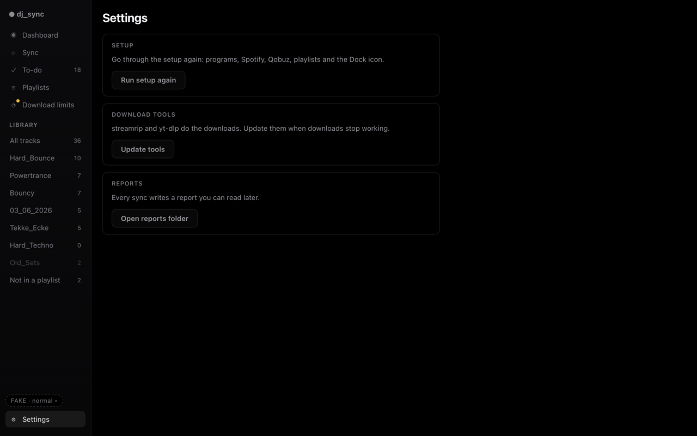 |
| Sync's end screen: counts in `StatCard`s, everything else in `Surface list`s, one Hint above the folder lists. | The old Settings page (replaced 2026-10-22, kept as the example): captions, sentences and buttons float on the black. Today's Settings puts each of them in the panel's labelled card. |

### Rule: each kind of choice has exactly one form

| Choice | Form |
|---|---|
| on/off, several items | `ToggleGroup` of `ToggleRow`s: switch · cover/icon · name · count; header "N of M on" with All · None; search from 7 rows (`search={false}` for a fixed set the app defines) |
| one of up to 6 | `Segmented`, with counts where useful |
| one of many | a selectable list |
| filters over a list | `Segmented` on one line, never wrapping; the rest go into its "More" menu |
| a single on/off setting | a switch in a row of a grouped list |

`Segmented` segments are equal width. When the full labels don't fit, the strip turns **tight** by itself (measured):
the unchosen segments may shorten to "…", the chosen one keeps its label (capped at half the strip, only while tight). More than `max` (6) options go into "More ▾",
and the chosen one always stays on the strip. `ChipGroup` is outdated: To-do uses `Segmented` (`max` 5: All and four
groups, then More); Library uses it for its quality filter. A strip with only one option (All) is left out.

| Do | Don't |
|---|---|
| 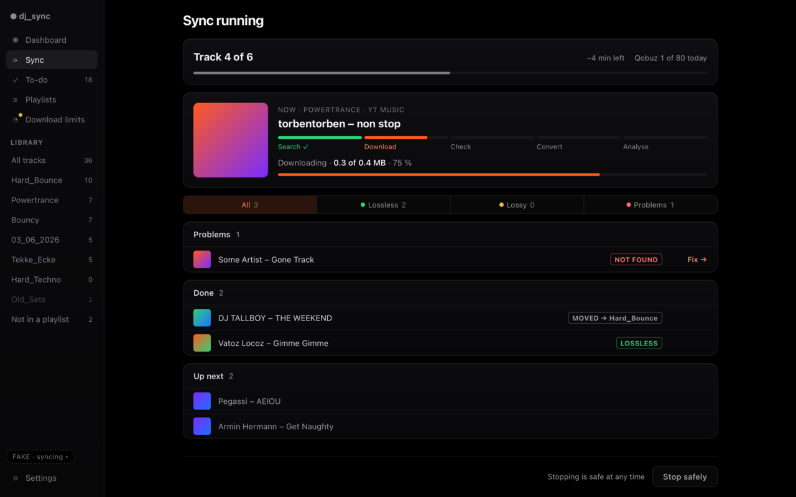 | 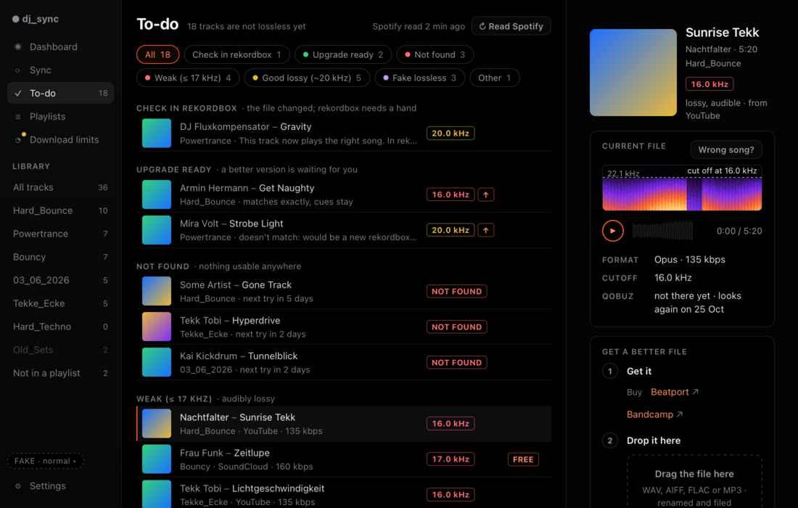 |
| The running sync: All · Lossless · Lossy · Problems as one `Segmented` with dots and counts, edge to edge. | To-do at 1100 before its redesign: `ChipGroup` pills wrap onto two lines and stop short of the rows' edge. |

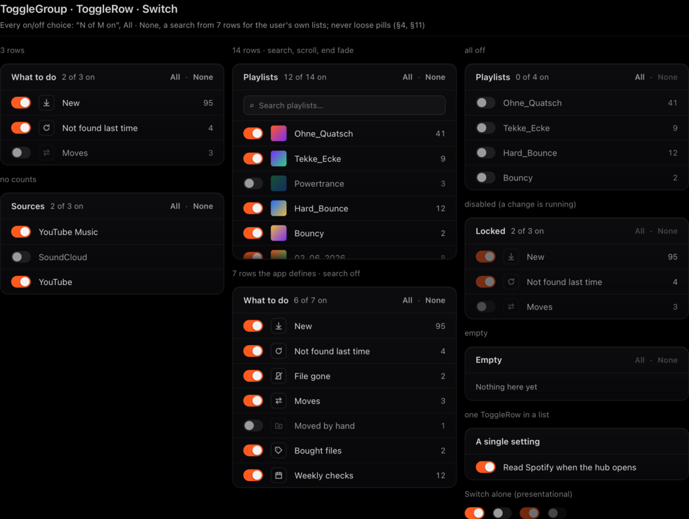
*Do: gallery, ToggleGroup · ToggleRow. An off row stays readable (`--text-muted`); the switch carries the state.*

### Rule: rows sit on a column grid
Use `ListRow`: fixed lead columns (tick, cover), a flexible name, fixed trailing columns (badge, count, action). Counts
right-aligned with tabular digits; covers one size per list; badges in their own column. A row action that only some
rows have gets a fixed-width slot (`--w-row-action`, 64 px) in every list of the view, so badges line up down the page.

### Rule: one filled button per screen
`Button` variants (`lib/components/Button.svelte`):
- `filled`: the one main action of a screen, or of a dialog (it sets `data-primary`). **One per screen.**
- `primary` (orange outline): a forward step that isn't the main one. `secondary`, `danger`, `link` (minor actions),
  `icon` (an icon-only row action such as ⊘; `destructive` turns it red on hover).
- Natural width always; `wide` only in a panel foot. `icon` is a 26 px square at least (`--h-ctl-sm` as its
  min-width, so the checker reads it as its natural size).
- An action inside a line of text is `Button variant="link"` (Sync's "Download limits →" in the day card), never a
  raw `<a>`: it brings the press dim and the off state.
- `ghost` is **outdated** (an alias of `secondary`); phase 2 maps each use to `secondary` or `link`. No block uses it
  any more (ConfirmHost's Cancel is `secondary`), and the guard fails a new one.

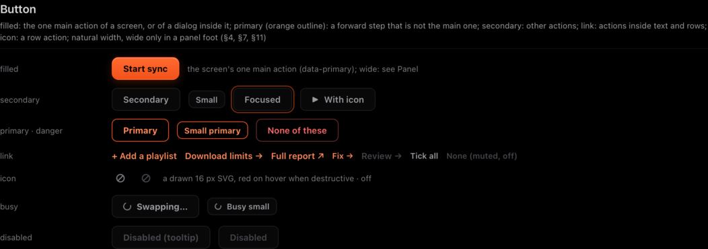
*Do: gallery, Button. Don't: no old shot is left; the checker fails a second filled button (`primary`) and a stretched
button (`button`).*

### Rule: colour has fixed jobs
Orange = action and selection, and the user's own usage and change (Download limits' usage bars, the new limit line).
Green, yellow, red, purple, grey = quality. Red also = a problem. Yellow also = waiting or limited (`NoteCard` `warn`,
the Download limits dot). **Risk** is the one other job green, yellow and red have: how safe a pace is (green safe,
yellow easier to notice, red risky), through the `--risk-*` tokens, and only on Download limits' `RiskScale`, its
verdict, the 14-day bars and a service's status. No other colours. A read in progress is status, so it is neutral
(Sync's reading card), not orange.

| Do | Don't |
|---|---|
| Download limits: the risk scale, the verdict and the 14-day bars in green → yellow → red; usage bars in orange. | Download limits' first mockup: risk and pace in grey to keep the quality colours "quality only". The user found it "absolutely horrific and depressing": grey can't say how safe something is. |

---

## 3. Look: OLED with depth (§5)

- Background `#000`. Text keeps 4.5:1 on its surface: labels and counts `--text-label`, sidebar `--text-nav`, both
  dimmer than secondary text.
- **Surfaces** are slightly raised (gradient fill, 1 px hairline, inner top highlight, radius 12). Lists use their own
  gradient and row dividers `--line-soft`.
- Controls: border `--ctl-line`, fill `--ctl-bg`, radius 8, hover `--ctl-hover`. The filled button: `--go-bg`,
  `--go-highlight`, `--go-glow`, radius 10.
- **Type scale** (px): 11 labels (uppercase, tracking .7) · 12 small · 13 body · 17 title · 22 page title · 30 stat
  numbers (tabular) · 44 the countdown only. No other sizes (`--type-scale`; the checker reads it).
- One accent `#ff5a1f` (text on black `--accent-text`). Use tokens from `hub-ui/src/lib/styles/tokens.css` only; the
  checker fails any colour that isn't a token value.
- A Surface's label is a title in sentence case (13 px semibold), its summary 12 px muted; uppercase stays for values
  and panel captions. Never rewrite the user's folder names.
- A size that a rule names, or that two places share, is a token, never a literal in a page: `--h-btn` (34 px: buttons, the PageHeader's row,
  TextField), `--h-ctl-sm` (26 px: small controls, the icon button's square, the DayBar), `--w-row-action` (64 px: a
  row's action or number slot), `--gap-split` (3 px: the DayBar's split), `--dim-locked` (.5: the one dim for "can't use
  right now", a disabled Switch and the plan while Spotify is read), `--content-max` / `--content-max-wide` (the frames'
  `data-max` names them) and `--panel-w` / `--panel-w-narrow` / `--panel-narrow-below` (1240 px).

| Do | Don't |
|---|---|
| 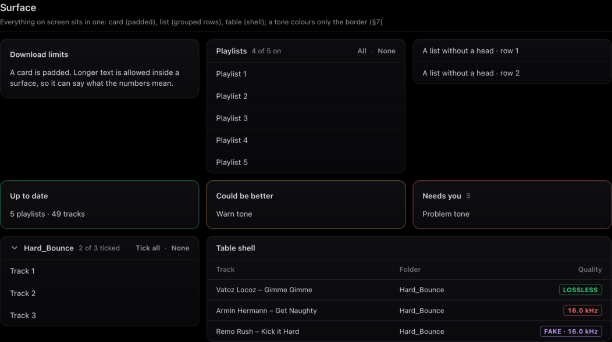 | 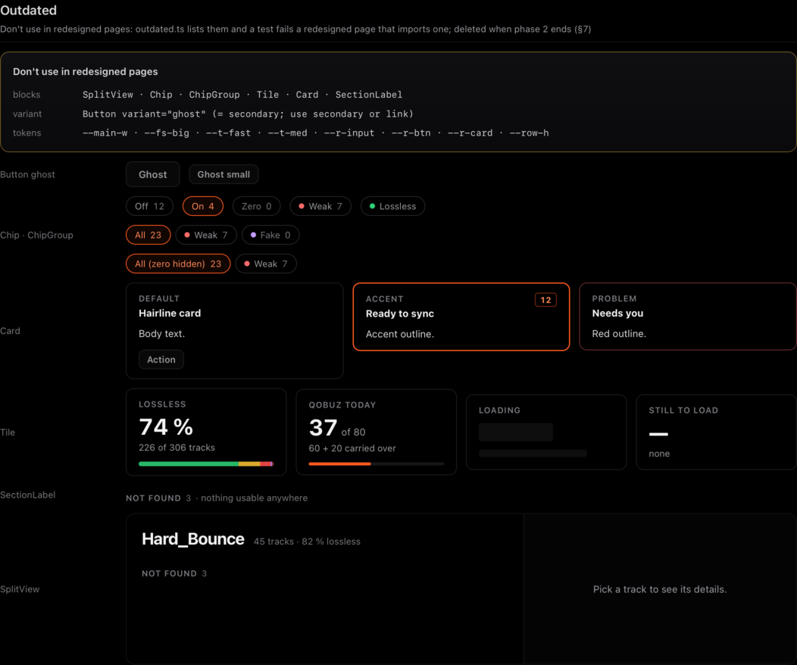 |
| Gallery, Surface: `card`, `list` (with header, `bulk`, `foldable`, `sticky`), `table`, and the tones. | Gallery, Outdated: the old hairline `Card`, `Tile`, `SectionLabel` and `Chip`s. Don't use them in a redesigned page. |

---

## 4. The page header (§5a)

Every page starts with one **`PageHeader`**; a page never builds its own title row (Setup too: "Set up Discjockey" with
Finish later in its `actions`).

```
[Title · status line] .......................... [page actions] [Playlists read 2 min ago  ↻ Read playlists]
```

- Props: `title`, `sub` (the status line, 12 px, on the title's baseline), `actions` (snippet: search, Full report),
  `readStatus` (show the read slot), `readStatusInBody`, `readStatusState`. The title never shrinks and the status line is
  never cut: when it doesn't fit beside the title it wraps under it, balanced, breaking between words and after a "·"
  (never before it), so the header grows by a line only where the words need it. Only a title longer than the whole
  lead (a folder name) ends in "…".
- The **read slot** (the playlists' read status, every service at once; the wire field is `read_status`, the block
  `ReadStatus`) is always last, so its right edge is the content's right edge. It is on Dashboard, Sync
  (before the start), To-do and Playlists. `ReadStatus` is placed only by this slot; the checker fails it anywhere
  else (`read-status`).
- The header spans its frame's content box (the list area, never the panel). Height at least 34 px; content starts
  `--s-3` under it, so it starts at the same y on every page.

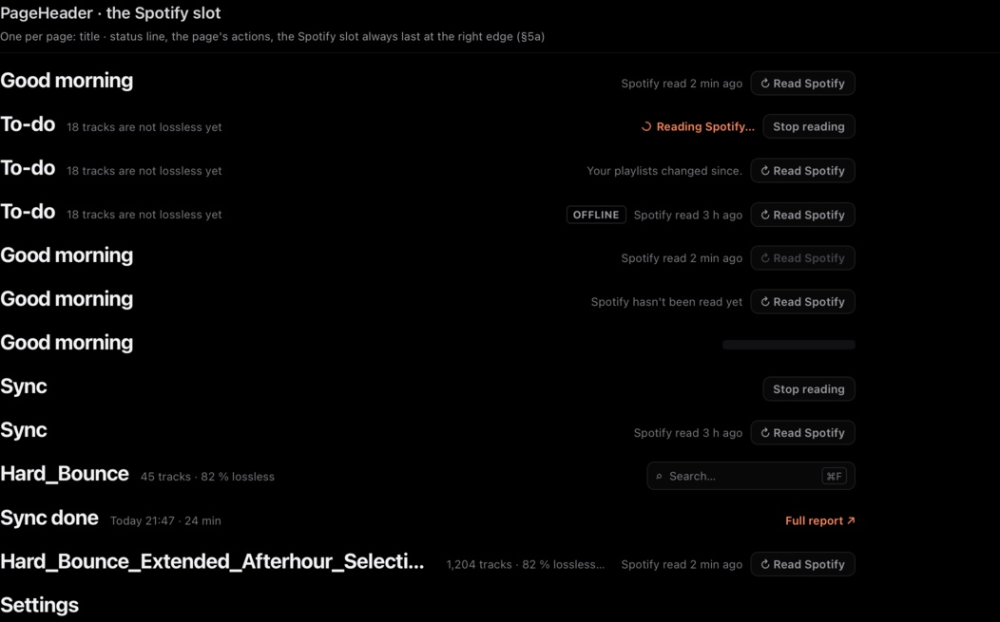
*Do: gallery, PageHeader. Don't: no old shot is left; before Task 10A, Dashboard put the Spotify status left beside
its greeting while Sync and To-do put it right, and Settings' title sat 12 px off every other title.*

### Rule: a state is said once, one action per intent (§11)
A state is said in one place, where the user looks for it, and each intent has one control. When you find a duplicate,
remove it on every page, not just yours.
- "The playlists can't be read" is two derived stores in `lib/stores/hub.ts`: `readBlocked` (yes or no; the header
  slot reads it and only turns Read playlists off, its reason "Connect Qobuz first.") and `readBlock` (which problem and
  which service; the shell's banner and Sync's card read it). Only a service `playlists.txt` uses blocks the read (a
  Spotify left out in Setup is no problem while no line is on Spotify). The banner says it with Connect {Name} →.
  One wording everywhere: `problemCopy(kind, { service })` in `lib/copy.ts`.
- Read playlists lives only in the header slot. Cards don't repeat it.
- **A page takes a banner over only through `bannersSaidInBody`** (`lib/stores/shell.ts`): the view that says the
  state in its body calls `$effect(() => sayInBody({ console, readStatus }))`, which clears itself when the view goes.
  The shell imports no page. A view never loses the warning: it claims a banner only while it really shows its own.
- **Sync's use of it:** the before-start view shows reading and Spotify problems as cards in its body
  (`readStatusInBody`), so the slot keeps only the control. It claims `console` only while it shows a plan (Start
  off, with its Hint "A sync is running in the terminal"), and `readStatus` only while the card above the plan can
  show. The up-to-date, empty and preview-error views keep the console banner (`sync-before-up-to-date-console`);
  the running and end views keep both banners.

---

## 5. Motion and text (§6)

### Motion
| What | How |
|---|---|
| Press | Only compact controls shrink: buttons `scale(.98)`, small and icon buttons `scale(.97)`, instantly on pointer-down (`--t-press`). Rows, headers, disclosure toggles and joined segments highlight (`--ctl-press`); text links dim (`--link-press`). |
| A state change that confirms a decision (switch, tick) | `--t-state` (200–260 ms), `--ease`. |
| Hover | `--t-hover` (120 ms). |
| Selection after navigation or an arrow key (sidebar, `Segmented`) | Instant. |
| A value that changes on its own (bar, ring, quality bar after a refresh) | `--t-value` (~420 ms). A value shown for the first time is drawn at once; **bars don't fill on load**. |
| A value the user just caused (the DayBar after an amount click) | `--t-reply` (280 ms). |
| Live progress during a sync | linear, `--t-live`; nothing bounces. |
| Popovers and menus (InfoTip, More, context menu) | Fade and grow from `scale(.97)` at the trigger, `--t-pop` (140 ms); close at once. **Once one tip is open (or just closed), the next opens instantly** (`infoTipModel.ts`). Modals only fade. |
| Entrances | At most a ≤ 150 ms fade. CSS transitions only; nothing waits for an animation. Reduced motion: fades only. |
| The frame's foot (plan now-playing) | Appear: up from the window's bottom, 220 ms, strong ease-out (the page makes room at once, only the contents move); Stop: down, 180 ms. Hide: the bar's contents move 40 px left towards the sidebar's corner and fade, 240 ms ease-in-out, then the row fades in; Show: the same path back, 280 ms. Track change, play/pause, shuffle and the keys: instant. Reduced motion: cross-fades. |

`ProgressBar` has `pace`: `value` (moves on its own), `reply` (answers the user), `live` (a running sync). Placeholders
are **the real blocks waiting**, never measured px: `StatCard value={null}` ("—") and `QualityBar by_quality={null}`
(a shimmering track and one cap-height legend line), so height and radius match by construction and nothing jumps
when the numbers draw. `Skeleton` (`shape="card"` takes `--r-surface`) only stands in for content no block can wait
in.

No screenshot can show motion; the gallery shows each `ProgressBar` pace and the DayBar's reply live.

### Text
- Panels use labels and numbers, not sentences.
- `Hint`: at most one line, directly under (or beside) its control. `tone="problem"`: the error the user's own
  action just caused, in red, announced (`role=alert`), the backend's words cut to one line (LiveView's stop refusal).
- `InfoTip` holds text only, no links or buttons (a `role=tooltip`); its ⓘ has no expanded state.
- Anything longer goes behind an ⓘ (`InfoTip`) or into a `NoteCard` (icon + up to about three lines; tones `info`,
  `warn`, `problem`; title only is fine). Never loose on the background.
- Plain English for a non-technical DJ (`CLAUDE.md`).
- **Shared formats** (`lib/format.ts`): every estimate uses `estimate` / `estimateText` ("~75 min" below 2 h, then
  "~2.5 h"); measured times use `minutesLong`; service rows use `serviceName` ("YouTube", not "YouTube Premium").

| Do | Don't |
|---|---|
| 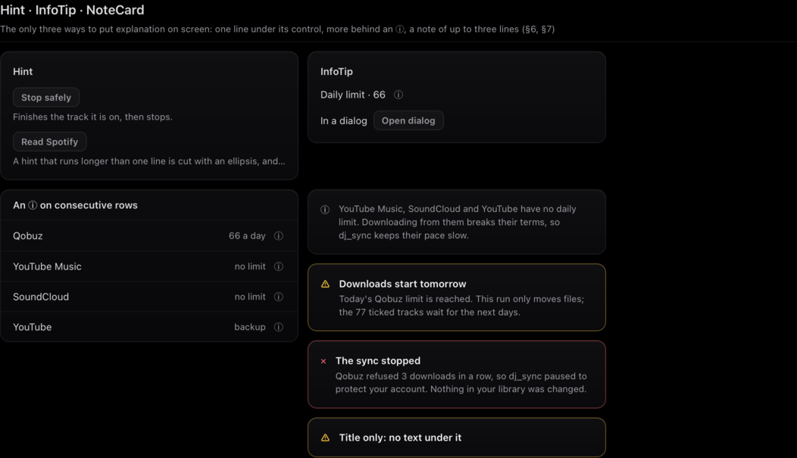 | 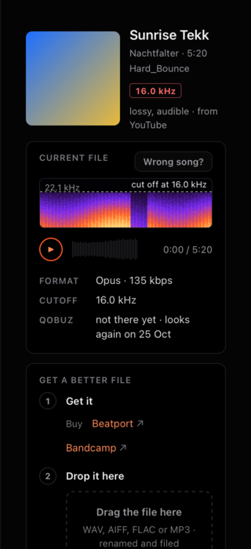 |
| Gallery, Hint · InfoTip · NoteCard: the only three ways to put explanation on screen. | To-do's detail panel before its redesign: explanation as loose sentences ("not there yet · looks again on 25 Oct", the drop zone's lines). |

---

## 6. Building blocks (§7)

All in `hub-ui/src/lib/components` (frames in `hub-ui/src/lib/frames`), exported from each folder's `index.ts`, and
shown in the gallery (`#/dev/gallery`; the section's `data-test` is given). Pages use only these. **A pattern no
block covers is never built in a page:** stop and flag it; it is added centrally (block + gallery + this doc), then
used.

| Block | File | Gallery | What it does |
|---|---|---|---|
| `ListPanelFrame`, `ColumnFrame` | `lib/frames/` | `gallery-frames` | The two page frames (§1 here). |
| `Panel` | `lib/frames/Panel.svelte` | `gallery-panel` | `head` / `fill` / `after` / `foot`. |
| `PageHeader` | `lib/components/PageHeader.svelte` | `gallery-page-header` | Title · status line, actions, the read-status slot. |
| `Surface` | `lib/components/Surface.svelte` | `gallery-surface` | `card` / `list` / `table`; `label`, `summary`, `tone`, `foldable`, `sticky`, `bulk` (All · None), `hint` (a group's one-line hint after the count, printed like `ListSection`'s: no dot between name, count and hint), `fitLabel` (the label is a folder's path, fitted into the head's free width like a watched folder's: `~` for home, parents giving way in whole folders, the folder's own name last; the full path is the tooltip; a path that is not whole beside the head's links goes on a line of its own and the links wrap below it, and is cut only when even the head's width is too narrow), `header` (a Hint there gives way with the label), `grow` (`{ rows, tall? }`: fills its column up to its rows, 3-row minimum plus a peek, rows scroll inside; shared measuring with ToggleGroup in `growFill.ts`); `columns` (a table's column head, ruled and fixed above the rows, a `list` container of the rows' width so optional columns match) and `scroller` (bindable: the rows' scroller of a `grow` surface, for a table that renders only its visible rows); sets `data-surface`, `data-scrolls-itself` with `grow`, the fold `data-row-hit`. |
| `Button` | `lib/components/Button.svelte` | `gallery-button` | `filled` · `primary` · `secondary` · `danger` · `link` · `icon`; an `icon` can be a toggle (`pressed`: accent text on `--accent-wash-strong` plus a dot, `aria-pressed`, the foot's Shuffle) and `size="xs"` (22 px, a row inside the sidebar). |
| `ToggleGroup`, `ToggleRow` | `lib/components/` | `gallery-toggles` | On/off rows; `grow` inside a Panel `fill` (one per Panel); search from `SEARCH_FROM` rows (the query clears below it); `disabledReason`: each row's tooltip and a Hint in the head in place of All · None (gallery "Locked"). A `ToggleRow` alone in a `Surface kind="list"` is a single setting; its `sub` is a wrapping second line (the setting's detail, or why it is locked; Playlists' "Rename the folder on disk too"). |
| `Segmented` | `lib/components/Segmented.svelte` | `gallery-segmented` | One of up to 6; counts, dots (none at a count of 0), More, tight mode. |
| `StatCard` | `lib/components/StatCard.svelte` | `gallery-statcard` | 30 px number + unit + label; a bar or ring as its child; `value={null}` is "—", also its loading state; `wrap`: a label that is a sentence (the cutoff's "a lossy file inside the AIFF") takes a second line whole instead of ending in "…". |
| `DayBar` | `lib/components/DayBar.svelte` | `gallery-daybar` | Today vs later; no limit; limit reached. Day mode (`input.day`, Dashboard): used today (filled, quiet) · this sync · left (outline) or later. Input from `dayBar` (`dayBarModel.ts`). |
| `DeltaBar` | `lib/components/DeltaBar.svelte` | `gallery-deltabar` | A signed change either side of a centre line, `--w-row-action` wide: a gain grows right in the accent, a loss left in grey; every row of a list passes the same `max`, so lengths compare. The number sits beside it (the caller's). Playlists' move view. |
| `SelectCard` | `lib/components/SelectCard.svelte` | `gallery-selectcard` | One of a few things to pick, as a card that shows its state where you click (`title`, children: usage bar, status); picked = accent edge, `off` = dashed; a row of them is a tablist, ← / →. |
| `RiskScale` | `lib/components/RiskScale.svelte` | `gallery-riskscale` | A number on five equal risk steps in the risk colours; handle 1:1 with the pointer (no transition), `saved` as a tick, keys ← → / Page / Home / End. |
| `StatusMark` | `lib/components/StatusMark.svelte` | `gallery-riskscale` | A state as colour plus shape: ✓ green, ! yellow, ▪ red; `quiet` = outlined ✓ for a check that passed; `none` = an empty dashed circle, neutral, for nothing set up (the ladder's account chips); `back` = a neutral ↩ in a grey ring, a move that will be undone (Playlists' undo confirmation). |
| `AwayTag` | `lib/components/AwayTag.svelte` | `gallery-badge` | Why a track's file isn't there to play, in a list row: the `warn` `StatusMark` (the `!` a watched folder's row shows for the same state) and the panel's short words, "Offline" · "Folder not found" · "File not found", muted 12 px, never cut; the panel's whole line ("Offline: connect the drive") as its tooltip. Library puts it in the quality column of an away row (`file_state`), the one fixed column that holds "Folder not found" at every width. |
| `SourceLadder` | `lib/components/SourceLadder.svelte` (+ `ladderModel.ts`) | `gallery-sourceladder` | Where the music comes from, best first, as a `Surface card` (Settings, Setup): four rungs on a chain (Qobuz · the artist's own file · Premium streams with a chip per account · free streams), each lit in its quality colour or greyed with an outlined node and the chain dashed past it; the state in words on every rung's sub-line; the quality as a `Badge` beside the name, so the sub-line and chips take the full width under it. One `Hint` under it from `ladderLine` (spec settings-setup §4), the one Hint allowed a second line (never a third): the conclusion is never cut short at Setup's 372 px. `onpick(row)` makes Qobuz's name (a text link) and the chips (26 px buttons, the state read out as "YouTube Premium: signed in") pick a row; a chip that is paused or used up for today is a link to Download limits instead (`limitsHref` → `#/limits/<service>`, on every page: the pause is explained and lifted there); `compact` uses the short sub-lines; `downloads={null}` waits (greyed, Skeleton lines). Rungs 44 px (`compact` 40), colours only fade (`--t-state`). |
| `AccountPanel` | `lib/components/AccountPanel.svelte` (+ `accountModel.ts`, controller `accountFlow.svelte.ts`) | `gallery-accountpanel` | One download login (Qobuz, YouTube Premium, SoundCloud Go+), shared by Settings and Setup (spec settings-setup §5). Presentational: renders `phase` (`PanelPhase`: looking · error · found · none · unreadable · waiting · checking · result · working · no_premium · form) and calls `actions` (an `AccountFlow`, the only part that talks to the bridge). Full form: a `Panel` whose head is the gain `StatCard` (256 kbps against about 130 on two bars in the quality colours; Qobuz: its tracks over their share) and the state card, labelled with the service, the risk note behind the ⓘ at the head's end; every line of the card keeps a 16 px gutter (the state's mark, a spinner, nothing) so its sentences share one edge; the foot holds the phase's one filled action (`mainAction`), nothing while it works or waits; `disabledWhy` (`accountBlocked`) is the one Hint, under the button it turns off. `compact`: one Surface card per service (mark · name · state or what it gives · "optional" until it works · ⓘ), its action `filled` only when the page passes `filled`, else `primary`. Qobuz: e-mail + `SecretField` (the password leaves the element only through `takeSecret`), "Google, Apple or Facebook account?" opens a `NoteCard` with the three numbered steps and Set a Qobuz password ↗. "Another browser ▾" is a `ContextMenu` of every browser × profile, marked. Sign out sits beside any saved login (also one that stopped working); a paused or used-up account adds "Download limits →"; a result with nothing to try again (`dismissable`: a failed sign-out, System Settings that didn't open) gets a muted "OK" link back to the account's own state, and Qobuz's failed Check again brings the fields back under its words — no phase is a dead end. |
| `StepStrip` | `lib/components/StepStrip.svelte` | `gallery-stepstrip` | Where you are in a short guide (Setup): one row of equal steps, a number in a ring (✓ when done) and the label. `steps` of `StripStep` (`key`, `label`, `state`: `done` · `current` · `open` · `locked`, `done` also marks the current one ✓); `onpick(key)`. Done and open steps are buttons (`data-step-hit`: they fill their equal share, which the `button` rule allows); the current one carries the accent wash and `aria-current="step"`; a locked step (waits for an earlier one) is no button, unfilled, its ring dashed. 34 px (`--h-btn`); in a narrow strip the others end in "…" and the current keeps its label. Unlike `Segmented`, a step can be not reachable. |
| `NumberedSteps` | `lib/components/NumberedSteps.svelte` | `gallery-numberedsteps` | Steps to follow in order: children are `<li>` rows, the text in one element, a control under it in the text column (CopyCode, SecretField, a button), the number in a 20 px ring. Setup's Spotify app, Qobuz's password steps in `AccountPanel`. |
| `AddRow` | `lib/components/AddRow.svelte` (+ `addRowModel.ts`) | `gallery-addrow` | Paste a Spotify or Qobuz playlist link → `add_playlist` → the found playlist as a card ("Qobuz · owner · 18 tracks"; an unreadable one with its service's own words as a wrapping problem Hint) with its folder name; a refusal or a playlist the service won't show is the engine's sentence as a wrapping problem Hint, a missing login a compact `ProblemCard` with its service's Connect → (only the bridge's sentence, no second button, while the shell banner already asks for that service's login) "Add to the list" calls `onadd(playlist, folder)`, which answers whether it went in (a boolean or a promise of one; the button stays busy meanwhile): only then the field and the card clear, so a refused save keeps the playlist for another try; `draft` is the list it adds to (`PlaylistRef`: duplicate and folder checks). `filled`: that button is the screen's one filled button (Setup's first playlist). Playlists' list head, Setup. |
| `ContextMenu` | `lib/components/ContextMenu.svelte` | `gallery-accountpanel` (shot `base-gallery-accountpanel-menu`) | A menu at the pointer or under its button (Segmented's More, a row's ⋯, Another browser ▾). Items may carry a unique `key` (two profiles with the same name) and a `note` in its own right column (`good` colours it as a working state). |
| `FolderField` | `lib/components/FolderField.svelte` (+ `lib/musicFolder.ts`, flow `lib/musicFolderFlow.ts`) | `gallery-folderfield` | A folder chosen with the Mac's dialog, never typed (Setup, Settings, the missing screen): the path in a recessed well (mono, `~` for home, "…" in the middle when narrow so the folder's own name stays, the cut part a whole number of characters so no blank sits before the name, full path in `title`), `Choose…` (`secondary`, `filled` by prop; `label` changes its words: `Choose where…`, `Change…`), one line under it from `checkLine`: `StatusMark` + `Hint` (a refusal or warning may wrap to three lines, `Hint wrap`); `disabledWhy` turns the button off and is that line instead (it wraps); `disabled` turns it off with no line (the page already says why, e.g. Setup's banner); no `onchoose` = shown only. Under 300 px of its own width (container query) the button sits under the path so the path keeps the full width and the folder's own name stays whole. Never calls the bridge. |
| `WatchedFolderList`, `ImportCard`, `UnreadableList` | `lib/components/` (+ `watchedFoldersModel.ts`, controller `watchedFoldersFlow.svelte.ts`) | `gallery-watchedfolders` | The watched folders and the import of the user's own music, shared by Settings → Watched folders and Setup's "Your existing music" (plan library stage 4, W2–W6). The list: a mark (✓ readable, ! offline or not found, a spinner while worked on) · the name over its state line (a row never shows the import's run numbers, only how many of its files wait; the Library says "Always watched") and its path on one line (a folder on another drive reads "Example Drive › Music/Sets": the drive's name whole and first, then what is inside it; whole while it fits, else the folders inside give way whole from the front ("Example Drive › …/Sets"), then the last folder's middle, then "Example Drive › …"; a folder on the Mac reads "~/Music/Old" and its parents give way from the front; measured with the row's font (`fitPathAction`), so no blank sits before the folder's own name, which stays; the full path is the tooltip; two folders with one name get their short path in the × label and the Remove dialog) · the files in the `--w-row-action` slot · × Remove in a 26 px slot (empty for the Library); `grow` in a Panel's `fill`. The card: the phase line over a `live` bar with Stop at the head's end, or the stopped / done / failed line; `oncontinue` puts Continue import in the card (Setup), Settings keeps it in the panel foot. The unreadable files: a foldable `warn` list, open up to five rows, each file's name a `MiddleText` (a long name gives way in its middle, so "…EDIT).wav" and "…EDIT)(1).wav" stay apart), "Tried again at the next import." as its last line. Presentational; `WatchedFoldersFlow` alone calls the bridge (Add folder… → check → add, Remove's dialog, Stop, Continue import) and reads the folders again while an import counts. |
| `MiddleText` | `lib/components/MiddleText.svelte` (`fitMiddleAction` in `fitPathAction.ts`, `fitMiddle` in `format.ts`) | `gallery-watchedfolders` (the unreadable list) | A name on one line that gives way in its middle only when its column is narrower, so its end stays readable; measured with the element's font; the full text is the tooltip. For names whose end tells them apart (file names: the unreadable list, Library's File row). |
| `PathText` | `lib/components/PathText.svelte` (+ `pathBreak.ts`) | `gallery-trackrow` (KeyValue's File), `gallery-dropzone` | A file or folder path that may take several lines (DropZone's "→ Library/Hard_Bounce/…", the "Is this the same song?" table's place): it breaks only after a "/" (and after a drive's "›"), never inside a folder's or file's name, spaces included; a piece wider than its box breaks inside itself as the last resort. `lead` (an arrow) joins the first piece. The text is the path, so it copies as one. A path on one line never uses it: `fitPathAction` / `MiddleText` / `FolderField`. The base `.path` class no longer sets `word-break`. |
| `CopyCode` | `lib/components/CopyCode.svelte` | `gallery-copycode` | A line to paste into the Terminal with its Copy link (`Button` link); the code wraps in its own column, so Copy stays at the first line's end. Without clipboard access it selects the line and says "Press ⌘C". |
| `SecretField` | `lib/components/SecretField.svelte` | `gallery-secretfield` | An input whose text stays in the element (a password, a Client ID): the page reads it out with `takeSecret` as the call goes out; `oninput` derives only a boolean or a check; `tone` ok / bad; `multiline` for a pasted line. Same box as `TextField`. |
| `SortHeader` | `lib/components/SortHeader.svelte` | `gallery-surface` (`g-surface-columns`) | One column's head of a sortable table: the name as a button of its natural width, ↑ / ↓ on the sorted column, `aria-sort` on its `columnheader` cell; `align="end"` for numbers. Library. |
| `ProgressBar` | `lib/components/ProgressBar.svelte` | `gallery-progress` | `pace` value / reply / live; `tone`. |
| `PlayButton`, `PlayerIcon` | `lib/components/` | `gallery-player`, `gallery-foot` | The round play/pause of every player (MiniPlayer, the foot, the Now playing row): accent ring, ▶ / ❚❚ drawn as shapes, a spinner while loading, grey ring when off; `size` 30 or 22. `PlayerIcon`: the player's 16 px line glyphs (⏮ ⏭ ⤮ ⌄ ⌃ ×) for `Button icon`. |
| `Foot`, `NowPlayingRow`, `SyncPart` | `lib/shell/` (+ `footModel.ts`) | `gallery-foot` | The frame's foot and the hidden player's sidebar row (rule "the frame is an L" above); `SyncPart` is the sync's long form (alone in the foot) or `short` ("Sync 4 of 6", at the player bar's right end), a link to Sync. Shell parts, placed by `App` and `Sidebar` only. |
| `QualityBar` | `lib/components/QualityBar.svelte` | `gallery-qualitybar` | The quality split with legend; `by_quality={null}` waits (gallery "waiting"). |
| `Hint`, `InfoTip`, `NoteCard` | `lib/components/` | `gallery-explain` | The only three ways to explain; Hint `tone="problem"` for an error beside its control. |
| `KeyValue` | `lib/components/KeyValue.svelte` | `gallery-trackrow` | A key and its value on one line (To-do and Library details, Settings' Download tools). The key is an uppercase caption (`caps`) by default; `plain` keeps a name's own spelling (`yt-dlp`, `streamrip`: normal case, muted); `keyWidth` (px) sets the key column (default 96) so a list of short names needn't reach in with `:global`. |
| `ListRow` | `lib/components/ListRow.svelte` | `gallery-listrow` | The row grid of every list; `off` dims the lead, not a `data-mark` tick; the hit area is `data-row-hit`; a row that becomes `selected` scrolls into view (`block: 'nearest'`: a row already visible does not move); `wrap` lets the sub-line wrap instead of ending in "…", for what must be read whole (a destination folder, a reason a file can't move); the row grows by its lines. |
| `Tick` | `lib/components/Tick.svelte` | `gallery-listrow` | The checkbox look inside a `ListRow` lead (the row's button is the control, `checked`): orange filled ✓, empty box, `mixed` – for a group control with only some ticked. Marks itself `data-mark`, so an `off` row never dims it. Sync's plan, Playlists' tidy-up. |
| `ListSection` | `lib/components/ListSection.svelte` | `gallery-listsection` | A group's head among one list's rows (name, count, hint, `--h-section` 32 px; no dots between them, and a single group's `Surface` head prints the same through `summary` + `hint`): a sibling of the rows, sticky at the scroller's top while its rows pass (heading level 3). A `Surface grow` with sections doesn't fade its top end (the stuck head is the edge) and gives its rows `scroll-margin-top`, so a row scrolled into view stops below the head. One anchored list with sections replaces stacked lists of groups (To-do). |
| `TrackHead`, `UpgradeCard` | `lib/components/` | `gallery-trackhead` | A details panel's head (To-do, Library): 64 px cover, title · "Artist · length · place" · `children`; nothing in it is cut: a long title and the "Artist · length · place" line wrap whole, the quality badge's words go under it, `action` at the title's end on its first line (To-do's Hide). The upgrade box: a good-tone Surface card (label, found date as summary), Now/New spectra, ComparePlayer, the cue verdict ruled off, the page's `actions`. |
| `ProblemCard` | `lib/components/ProblemCard.svelte` | `gallery-problemcard` | A problem as a problem-tone Surface card; `compact` one-line form; `actions`; `alert` only for a problem the user's own action caused; `service` (a playlist service's login: "Qobuz isn't connected." with Connect Qobuz →, no detail line repeating it); `hint` (the page's own line under the headline, e.g. Sync's "what is affected" for a missing login; replaces the stock hint); `offline` with a `service` reads "Qobuz isn't answering.". |
| `EmptyState`, `Skeleton` | `lib/components/` | `gallery-emptystate`, `gallery-skeleton` | Empty content; a placeholder of the content's shape. |

Sync's `Why`, `WhyMark` and `KindIcon` (`hub-ui/src/pages/sync/plan/`) are shared with the gallery. If another page
needs one, it moves to `lib/components` first (centrally).

The gallery's "Other components" (WriteButton, Badge, Cover, TrackRow, fields (CopyCode and SecretField have their own
sections), Banner, Dialog, Ring, Spectrum, player,
DropZone) are shared and in use, not reworked yet; phase 2 reworks each with its page. To-do no longer uses `TrackRow`
(its rows are `ListRow`s) and Library's table has its own cells, so `TrackRow` is in no page any more. A round icon button that isn't a `Button` (`PlayButton`,
the Wrong song dialog's preview, a playable `Cover`) states its size as `min-width`, so the checker reads it as
natural. `Cover` with `onplay` is a track's play button (Library's rows): ▶ over it while hovered or while `hint` (its
row is hovered), ❚❚ while `playing` (on `--cover-scrim`), a click plays or pauses; it stays out of the tab order,
the row's Enter plays.

**Outdated** (listed in `hub-ui/src/lib/outdated.ts`; deleted when phase 2 ends). `src/lib/outdated.test.ts` fails when
a redesigned page's folder, or any block or frame it can render (`lib/components`, `lib/frames`), imports an outdated
block, reads an outdated token or uses `ghost`. Imports count named, aliased and direct-path ones, either quote
(`lib/guards.ts`). Its list of allowed exceptions is empty since To-do's pass moved `UpgradeCard` onto `Surface`; a
block that needs a stay is listed there with its reason, and the test fails if a redesigned page imports it:
- Blocks: `SplitView` (→ `ListPanelFrame`), `Chip`, `ChipGroup` (→ `ToggleGroup` or `Segmented`), `Tile`
  (→ `StatCard`), `Card` (→ `Surface`), `SectionLabel` (→ a Surface label).
- Button `ghost` (→ `secondary` or `link`).
- Tokens: `--main-w`, `--fs-big` (→ `--fs-stat`), `--t-fast`, `--t-med` (→ `--t-press` / `--t-state` / `--t-value` /
  `--t-live`), `--r-input`, `--r-btn`, `--r-card` (→ `--r-ctl` / `--r-surface`). (`--row-h` went with Library's pass: nothing used it.)

---

## 7. The checker (§9)

`hub-ui/scripts/rules.mjs` (rules in `scripts/rules-page.js`) runs in WebKit against the fake-mode dev server it
starts itself, on every shot of every page in `REDESIGNED` (`hub-ui/src/pages/designSystem.ts`), at all three sizes.
Other pages are skipped and counted. `npm run verify` runs it (after `--self-test` against `scripts/rules-fixtures/`:
`good*.html` pass every rule, `bad-<rule>[--<case>].html` break exactly that rule; `<html data-viewport="WxH">` sets
a fixture's window).

```
cd hub-ui && npm run rules                                   # every redesigned page
npm run rules -- --page todo --force                         # one page while you build it (not yet in REDESIGNED)
npm run rules -- --page sync --only sync-many,sync-end       # only the named shots
```

| Rule name | Fails when |
|---|---|
| `overflow` | the document or any scroll container scrolls sideways |
| `max-width` | a frame's content is wider than the token its `data-max` names (`--content-max` / `--content-max-wide`), or the panel wider than `--panel-w` (`--panel-w-narrow` below `--panel-narrow-below`, 1240 px) |
| `frame` | the shot doesn't have exactly one `[data-frame]`, or has more than one `[data-page-header]` |
| `button` | a button is wider than its natural size (allowed: a `wide` button in a panel foot, and the hit areas that fill by design: segments, switch rows, menu items, `[data-row-hit]`, StepStrip's `[data-step-hit]`; a button in a list's head or a row's trailing cell is checked) |
| `primary` | more than one visible `[data-primary]` per screen, or per dialog |
| `clipped` | at 1100 × 700: a control outside the window and not in a scroller, or a `Panel` foot not fully visible |
| `loose-text` | more than 90 characters of text outside `[data-surface]`, `[data-note]`, `[data-infotip]` or a dialog (blocks set these markers; `lib/guards.test.ts` fails a page that writes one, or any other checker marker, by hand) |
| `font-size` | a text size not in `--type-scale` |
| `colour` | a text, background or border colour that isn't a token value (transparent is fine) |
| `read-status` | a `[data-read-status]` outside `[data-page-header]` |
| `error` | the page logged an error while the shot loaded |

Anything marked `data-dev` (the fake toolbar) is ignored.

**Reading a `FAIL` line** (an illustrative line in the real format):
```
FAIL todo-big@1100 loose-text: todo-list: 112 characters: "This track now plays the right song in r…"
     └ shot @ width └ rule      └ where     └ detail
```
- *where* is the nearest `data-test` above the element (or its tag name). Search for it in the page's `.svelte`.
- The run ends with `N redesigned pages · M skipped · T shots checked, F with problems` and exits 1 on any failure.

Fix the page, never the checker. If a rule seems wrong for a real case, stop and report it (§12 safeguard 2).

---

## 8. Reference page: Sync (§8)

Sync is built on the system in every state. When unsure how something should look, find the nearest Sync state.

| State | Frame | Shots (`hub-ui/screenshots/`) |
|---|---|---|
| Before the start | `ListPanelFrame` (`pages/sync/BeforeStart.svelte`, `plan/RunPanel.svelte`) | `sync-before`, `sync-many`, `sync-long-plan-all`, `sync-limit-reached`, `sync-no-qobuz`, `sync-qobuz-backup` |
| Reading Spotify, offline, console | same | `sync-reading`, `sync-rereading`, `sync-before-offline`, `sync-before-login-expired`, `sync-before-console` |
| Up to date | same (`plan/UpToDate.svelte`, `plan/UpToDatePanel.svelte`) | `sync-before-up-to-date`, `sync-before-up-to-date-wait` (`sync-last-wait` on the waiting StatCard), `sync-before-up-to-date-console` |
| Running, pause, stopping | `ColumnFrame` (`LiveView.svelte`) | `sync-downloading`, `sync-pause`, `sync-break`, `sync-stopping`, `sync-stop-refused` |
| End, failed, crashed | `ColumnFrame` (`EndScreen.svelte`) | `sync-end`, `sync-end-stopped`, `sync-failed-login-expired`, `sync-crashed` |

Each shot exists at `@1100`, `@1280` and `@2560`. Worth copying:
- The panel: count and run time `StatCard`s, the day card (`DayBar`, amount `Segmented`, one line with a link), then
  Playlists as a `grow` `ToggleGroup` in `fill`, What to do in `after`, Start sync (`filled`, `wide`) in `foot`.
- The plan: one `Surface list` per playlist (`foldable`, `sticky`, `bulk`), rows on `ListRow`, the why column only
  where a section can fill it.
- The end screen: three `StatCard`s (added across with the quality bar, then moved · need you), the rest as
  `Surface list`s; Done is the one filled button.

---

## 9. Improve what you touch, converge on decisions (§12)

**The existing look is evidence, not law.** No page, block or header is "how it is" just because it exists. Every
agent that designs, builds or reviews UI writes a critique of what its task touches before building (the reviewer
again on the result), with the `apple-design` and `emil-design-eng` skills loaded, at all three sizes:

- **Edges and alignment:** does every line of content start and end on purpose? Which edges are hard (search field,
  buttons, row ends), and does everything that should meet them meet them?
- **Grouping:** do related things read as one object, unrelated ones as separate?
- **Space:** is empty space chosen, or left over? What happens to it at 1100 and at 2560?
- **Hierarchy:** what does the eye land on first, and is that the most important thing?
- **Consistency:** does the same element look, sit and behave the same on every other page?
- **Intent:** was this element designed, or carried over? Minimal is good only when it's a choice that serves the
  content. If it's just what was left, design it.

Every flaw you can fix inside this design system, you must fix. Flaws you can't (system level, or outside your task)
go in your report. A critique that finds nothing lists what it checked. A flaw visible in the task's screenshots that
nobody flagged is a review miss, not a matter of taste.

**Consistency is absolute.** One element has one place, one look and one behaviour on every page. A shared element
(the page header, Spotify status with Read Spotify, the start button, filters) is placed by its block, never by the
page.

**Edges on purpose.** A line of content either spans its column or is one contained object (a `Segmented`, a
`Surface`). A loose row of separate items stopping short of a hard edge is a flaw. Spreading the gaps to fill the
width is not a fix.

**Safeguards against drift:**
1. **A reason, not a taste.** Every change names its reason: a skill rule, a spec section, or a measured problem
   (contrast, alignment, hit size, consistency, clipping). "Looks better to me" doesn't count.
2. **System changes are made once, centrally.** Tokens, frames, blocks, the header and shared elements change in the
   block, never as a page-local variant. A page agent who finds a system flaw reports it; the main agent applies it
   to the block, or rules against it with a reason.
3. **Decisions are recorded and stick.** Every system-level change goes into the decision log below, with its reason.
   It is reopened only for a reason the record didn't weigh (new evidence, a new requirement), never by restating a
   preference. A thing changed back a second time goes to the user.
4. **Taste goes to the user.** The user decides a new look, what a colour means, and the layout direction of a whole
   page type. Agents decide everything else and record it.
5. **Scope.** An agent fixes what its task touches. Flaws elsewhere go into its report and then `docs/issues.md`, so
   parallel agents never edit each other's ground.
6. **Done is finite.** A task is done when every flaw its critique found is fixed or recorded. Nothing is polished
   past that, and nothing is reopened without a reason under rule 3.

---

## 10. Decision log

Phase 1's decisions, with their reasons, are in spec §11 (`docs/2026-10-20-hub-design-system-design.md`). Search it
before reopening anything. New system-level decisions from phase 2 on go here, newest on top, one entry each:
**what changed** (block or token), **why** (the reason under safeguard 1), **where it was seen** (shot or page).

- **2026-10-29 · A path breaks after a "/", never inside a name (library stage 4 fix M).** New block `PathText` (`pathSegments`). Drop zone's "→ Library/Hard_Bounce/Nachtfalter – Sunris / e Tekk" at 1280: the base `.path { word-break: break-all }` broke a word anywhere, and the zone's own `overflow-wrap: anywhere` only made it worse; the same class served every path. Now a wrapping path is a row of unbreakable pieces (a folder and its slash; a file's name) with a break opportunity after each; only a piece wider than the box breaks inside itself, as the last resort. `break-all` is gone from `.path` and the gallery; the To-do compare table's place uses the block instead of its own `<wbr>` split. One-line paths (`WatchedFolderList`, `FolderField`, `Surface` `fitLabel`) never wrapped and are unchanged. Seen: `todo-weak-selected`, `todo-same-song` at 1100 and 1280.
- **2026-10-29 · A dimmed leftover row says why at every width (library stage 4 fix L).** The Library's dimmed row (a
  downloaded song that left every playlist) was explained only by the Folder column's "Not in a playlist", which is
  hidden at 1100. Its title cell now has a native tooltip: the full name, and under it "Not in any playlist any more"
  (`rowTitleTip`, `libraryModel.ts`). An away row keeps the name alone; its `AwayTag` has its own tooltip. A tooltip, not
  a visible mark: the dimming is the signal, the words are for the one who asks. Seen: `library-ejected-back`.
- **2026-10-29 · The spectrum's top label only shows with room above the cutoff line (library stage 4 fix L).** In the
  64 px strip a 16 kHz file's cutoff line is about 17 px from the top, and "22.1 kHz" sat on it, reading as "cut off at
  22.1 kHz". `showTopLabel(height, cut)` (`spectrum-data.ts`) now decides in pixels: a strip of 64 px or more, and the
  line at least a label and a gap (22 px) below the top; the old fraction rule (`cut < 0.8`) was only right at one
  height. Bigger strips keep the label for a deeper cut or none. Seen: `library-fake-qobuz-selected`, `library-ejected-back`.
- **2026-10-29 · An away row says why (library stage 4 fix K).** New block `AwayTag`. A Library row whose file is away
  (`file_state` `offline` or `folder_missing`: the drive is ejected, the watched folder isn't found) is dimmed like a
  leftover row (it can't play) and shows the `AwayTag` **in place of its quality badge**; its cover has no ▶, and
  double-click, Enter and the menu's Show in Finder do nothing. The page re-reads when a drive comes or goes
  (`DrivesChanged`), so the rows change while the window is open. Why: since fix G a dim alone means "a downloaded song
  that left every playlist", and the user read the old dim as "offline"; a second meaning for one grey can't be told
  apart, so the away row carries words, the panel's own ("Offline", "Folder not found"), with the `!` the watched
  folders use for the same state. The quality column because it is the one fixed column wide enough for "Folder not
  found" (112 px of 116) at 1100: in the title cell the tag left "Funken…" of the title at 1280 (tried, shot), and
  the 64 px UPGRADE slot holds "Offline" but not "Folder not found". While the file is away its quality stays in the
  panel and in the filter counts; it can't be played or checked anyway. Seen: `library-ejected`,
  `library-ejected-back`, `library-folder-missing-selected`, gallery `base-gallery-badge`.
- **2026-10-29 · A fitted path in a card head is whole before it is short (library stage 4 fix I).** `Surface` with
  `fitLabel`: when the path doesn't fit whole beside the head's links, the head wraps, the links drop to the next line
  (still at the right edge) and the path may take the head's whole width (`fitHeadLabel`'s `wrapRoom`); only a path
  longer than that is shortened. Measured first: the free width beside "Move to Superseded" (121 px of a 285 px head
  at 1280, of 245 px at 1100) was read right to the pixel, so "Example Drive › Music/Old" (166 px) really didn't fit
  beside it (156 px); the cut was the link taking half the head, not a measuring error. Why: the folder is what tells
  two copies apart, so it outranks keeping the link on the label's line. Seen: `todo-duplicates` at 1100 and 1280,
  gallery Surface `fitLabel`.
- **2026-10-29 · The cutoff sentence and the file name in the panel (library stage 4 fix I).** `StatCard` gains `wrap`
  (the cutoff card passes it): the label "where the highs end · a lossy file inside the AIFF" is a sentence, and at the
  320 px panel (1100) it ended "inside the …", losing the one word that says which file. It takes a second line instead
  (`text-wrap: pretty`, so a lone word isn't left alone); numbers' short labels elsewhere stay on one line. Library's
  File row is a `MiddleText`, so a long name keeps its extension ("DJ TALLBOY & T…Remaster).aiff") as the unreadable
  list's names do. Seen: `library-long-panel-selected` at 1100, 1280 and 2560.
- **2026-10-29 · The panel head cuts nothing (library stage 4 fix I).** `TrackHead`'s title and its "Artist · length ·
  place" line wrap whole instead of ending in "…" (the badge's words already did, fix H); no tooltip is needed any more.
  Library's head says only where the file sits (the folder, or "Not in a playlist"): "in 3 playlists" was cut at 1100
  and never named a playlist, so the playlists are a **Playlists** row in Current file, by name and wrapping, and
  To-do's panel gets the Source row Library already had instead of "· from X" in the head. Key columns of both Current
  file cards are 76 px (PLAYLISTS is the longest key). Why: the head is what tells which song and which file this is;
  a cut there is information the user can't get back, and the panel's body already scrolls when the head grows. Seen:
  `library-long-panel-selected`, `todo-fake-selected`, gallery `gallery-trackhead` (a long title).
- **2026-10-29 · `Segmented`: a segment with a count of 0 has no dot (library stage 4 fix I).** The quality dot says
  "there is something of this quality here"; at 0 nothing is, so a green dot on "Upgrade ready 0" promised an upgrade
  that does not exist. The dot is left out in the block (`o.dot && o.count !== 0`), so every strip does the same; the
  label and the 0 stay, and a segment without a count keeps its dot. Seen: gallery `gallery-segmented` ("a count of 0"),
  `library-folder-no-upgrades`, `todo-filter-none` (the chosen "Weak 0").
- **2026-10-29 · Why a file or folder isn't there (library stage 4 fix F3).** `Spectrum`'s `offline` flag becomes `away`
  (the words to show instead of "No file yet"); `WatchedFolderList` rows gain the state `missing` (mark `warn`, line
  "Folder not found: moved, renamed or deleted? Put it back or remove it here."), Settings' and Setup's summary says
  "{name} isn't found" for it. Why: an unplugged drive and a renamed folder need opposite actions (connect it, put it
  back or remove it), so one "offline" misled; the panels now say "Offline: connect the drive", "Folder not found" or
  "This file isn't there any more." by `file_state`. Seen: `settings-folders-missing`, `library-folder-missing-selected`,
  `library-file-missing-selected`.
- **2026-10-29 · `QualityBadge` gains `checked` (library stage 4 fix).** `checked={false}` draws a neutral "Not checked" `Badge` (muted tone: no quality colour, no kHz, no upgrade mark) for an imported file whose sound isn't judged yet; the colours return when the sound check has run. Why: until then the quality is only the codec's guess (every WAV read LOSSLESS, and the panel said "verified lossless"), so a colour or a kHz figure would be a verdict nobody reached. The panel's words read "sound not checked yet" (`qualityWords`) and its cutoff card is left out. Seen: gallery `gallery-badge`, `library-unchecked`, `library-unchecked-selected`.
- **2026-10-29 · To-do's import cards, Sync's two notes (library stage 4 fix round).** `Surface` gains `hint` (the single-group head now prints name, count, hint exactly as `ListSection` does, no dot) and `fitLabel` (a duplicate's folder as the card label, so copies in two folders named "Music" read differently); `PlayButton` gains `subject` ("Play Neonfieber.aiff" for a screen reader). Same-song questions and duplicate groups are never dimmed (`rowOff`): they are about the user's own files, which no playlist holds. Sync's W9 lines are `NoteCard`s, not wrapping Hints (a Hint is one line): the waiting answers as a `warn` card with To-do → as its action, the upgrade-checks note an `info` card right under the day card (a card inside the card would be a container in a container). After an answer, Keep or Move to Superseded focus goes to the newly selected row. Seen: `todo-duplicates*`, `todo-same-song*`, `sync-waiting-answers`.
- **2026-10-29 · Library rows follow the same rule (library stage 4 fix G).** A Library row dims only when its song left every playlist and the file is a downloaded one (`rowOff`: `!in_playlists && !own`, `own` sent by the engine's `track_row`); a file of the user's own is never dimmed. Why: the 2026-10-29 To-do rule says no playlist holds an own file, so a dimmed row read as "gone" about every imported song. Seen: `library-not-in-playlist` (both kinds).
- **2026-10-29 · Stage 4 live-check fixes: names give way in the middle, a drive's name stays whole.** New block `MiddleText` (file names in the Couldn't-read list; `fitMiddle`): the end of a long name is what tells two apart, so only the middle goes, and only when it overflows. A watched folder on another drive reads "Drive › rest" (the drive tells which one to connect; it was the first thing the old form cut); folders on the Mac keep "~/…". A file on an offline drive says "Offline: connect the drive" where its spectrum would be (`Spectrum offline`), not "No file yet", and offers no Show in Finder. Seen: `library-offline-*`, `settings-folders-long-names`.
- **2026-10-29 · Watched folders (library stage 4): `WatchedFolderList`, `ImportCard`, `UnreadableList`; Settings row and Setup step.** Settings gains **Watched folders** in This Mac after Music folder (the plan said "the first group", which is Downloads; both rows say where Discjockey looks for music on this Mac), its panel: the import card (head), the folders (`fill`, grow), the unreadable files and Add folder…'s line (`after`), and Add folder… or, while files wait, Add folder… · **Continue import** (foot). An offline drive marks the row `warn` but never makes `#/settings` open it (it only waits). Setup gains step 2 **Your existing music**, optional: Continue is always on and skips it when no folder was added; Add folder… is the filled button until the step is done (`StepFooter filled`). Why: one set of blocks for both places so they can't drift; a growing list of folders anchored in the panel; the path sits on one line with a middle ellipsis (full path as the tooltip; two folders that share a name are told apart by their short path in the × label, the Remove dialog and Settings' offline line); the unreadable rows say "{folder} · {reason}". Seen: `settings-folders-*`, `setup-existing-*`, `base-gallery-watchedfolders`.
- **2026-10-25 · Playlists from more than one service (library stage 3): the service as a word, no mark; read words
  service-neutral; `PageHeader`'s title keeps its width.** A Playlists row's second line starts with its service
  ("Qobuz · "Qobuz Picks" · Example Curator"; AddRow's found card and Setup's list the same), on every row, not only in
  a mixed list, so a row always looks the same. No graphic service mark: a word needs no learning and no brand art,
  brand colours would break colour's fixed jobs, and a new look is the user's call — stage 5's sidebar icons are that
  decision, and the row's word can become its block then. An unreadable playlist says its service's own words (the
  engine's hint), in red, whole in the tooltip. The read slot says "Playlists read …" / "↻ Read playlists"; its
  reason, the banner and Sync's card name the service that blocks the read (`readBlock`, `ProblemCard service`). The
  W10 words made the slot longer and Playlists' title read "Playl…" at 1100: flex cut a short title by its share of
  the shortfall (any shrink factor draws "…" from a fraction of a pixel), so the title no longer shrinks and the status
  line gives way first, as this doc already said it did. Seen: `playlists-qobuz-row`, `playlists-qobuz-unreadable`,
  `playlists-qobuz-not-connected`, `sync-before-qobuz-not-connected`, `dashboard-qobuz-not-connected`,
  `setup-spotify-skipped`, `settings-spotify-skipped`.
- **2026-10-23 · Now playing lives in the frame's foot; hide folds it into the sidebar.** The sidebar and a 44 px
  foot are one L-shaped frame in one material (painted once by `App`), the line only along the page; the page's lower
  edge is the position; the sync's status moves into the same bar; Hide folds the bar into a Now playing row above
  Settings. New: `Foot`, `NowPlayingRow`, `SyncPart` (was `ActivityBar`), `PlayButton`, `PlayerIcon`, `Button icon`
  `pressed` and `xs`. Why: it covers nothing, it costs only the 44 px the sync bar already cost, one bar instead of
  two stacked, and hide/show move along one path (spatial consistency); a floating pill over a reserved strip and a
  player card in the sidebar were rejected by the user. Changed from the mockup: the icon buttons are the system's
  26 px `Button icon` (mockup 28), and while a track loads the bar shows its known length instead of "–:––" (it
  comes from the list, so nothing changes when the file arrives). Seen: `base-gallery-foot`, `library-now-playing`,
  `library-now-playing-hidden`, `base-shell-foot-sync`, `base-shell-foot-hidden-sync`.
- **2026-10-23 · The update notice: one `ExternalLink` line under the brand, no new block.** When a newer version is out
  (`HubState.app_update`), the sidebar's head gets a second line at `--fs-label`, on the brand's left edge, in the
  link's own accent colour (links are the accent's job): no badge, no alarm colour, no animation; the nav moves down
  by that one line only while it shows. The spec's words stay: "Discjockey 1.1 is available ↗" is about 160 px and
  the sidebar text 135 px, so at 168 px it wraps with `text-wrap: balance` into two even lines ("Discjockey 1.1" / "is available ↗"), left-aligned on the
  brand; it looked calm in `base-shell-update`, so no shortened wording and no ellipsis (a cut sentence would read as
  broken). Settings → About shows
  "Up to date" as a quiet state line, or the full sentence as the same link plus one note; with no answer it shows the
  version only. An update is never a problem: the About row's mark stays empty and `firstAttention` ignores it.
  Seen: `base-shell-update`, `settings-about-up-to-date`, `settings-about-update`, `settings-about-unknown`.
- **2026-10-23 · About row and five Setup steps; `ListRow selected` scrolls into view.** The Dock step is gone from
  Setup (it ends after First playlist, whose button reads Finish) and Settings' Dock row became **About Discjockey**
  (the version and Show licences): the app is the bundle now, there is no script app to make. While the status loads
  the About card shows a `Skeleton` line, never "Version " with nothing after it. A selected `ListRow` now scrolls
  itself into view (`nearest`, instant) instead of Settings doing it in the page: any list reached by its address or
  the keyboard, such as the "This Mac" rows below the fold at 1100 x 700, shows its chosen row. Why: a pattern that
  every "one of many" list can need belongs in the block, not in one page. Seen: `settings-about`,
  `settings-about-loading` (1100 and 2560), gallery `ListRow` ("one of many").
- **2026-10-23 · `KeyValue` gains `plain` and `keyWidth`.** Why: its keys are always uppercase captions, which is right for
  words like Format, Source and ISRC but turned the program names in Settings' Download tools into "YT-DLP" and
  "STREAMRIP": identifiers read as shouted acronyms, and spelled differently from the same names in the prose and in
  the "On this Mac" card above. The page had also reached into the block (`:global(.kv)`) to narrow its key column.
  Both are now props, so a page never overrides a block; `plain` renders the key in normal case, muted. Seen:
  `settings-tools`, gallery `KeyValue plain`.
- **2026-10-23 · `FolderField` block, `Hint wrap`.** A folder is chosen with the Mac's dialog, never typed; the field shows where it is and what is there (✓ new · empty · a Discjockey library, ! other files, ▪ the engine's refusal). The path sits in a recessed well, not a TextField box, because a box invites typing. `Hint` gains `wrap` (up to three lines) for a refusal or a warning only: the engine's reasons run to 125 characters and end in what to choose instead, which one line at Setup's 372 px cut off. Why: one way to pick a folder in Setup, Settings and the missing-folder screen. Seen: `base-gallery-folderfield`, `base-shell-music-missing`.
- **2026-10-22 · Final review: no dead ends in `AccountPanel`; `SourceLadder`'s paused chip links to the limits;
  `AddRow` clears only after the add.** Why: a failed Qobuz Check again left a panel with no field and no button, and
  a failed sign-out a message with nothing under it; every result now offers its retry, the Qobuz fields, or an OK
  back. A paused or used-up chip said "see Download limits" but opened the account row, which can't lift a pause; it
  now goes to `#/limits/<service>` (the panel says the same with "Download limits →"). Setup's first playlist vanished
  before its save answered, so a refused save meant pasting the link again. Seen: `settings-paused`,
  `settings-qobuz-rejected`, `setup-downloads-waiting`.
- **2026-10-22 · Setup redesigned (`REDESIGNED` gains `setup`); `CopyCode`, `AccountPanel` fixes.** Setup's shots
  (`pages/setup/shots.json`, 19 states: each step, every sign-in phase, timed out, cancelled, no browsers, Safari
  without Full Disk Access, a console run, the engine not answering) now run under the checker. Fixed in the blocks,
  so Settings gets them too: **`CopyCode`** keeps Copy beside its code when a parent stretches it (`justify-content:
  start`; the two auto tracks shared the free width, so on Setup's Spotify step Copy sat ~70 px right of the
  redirect address); **`AccountPanel compact`** drops "optional" once a login works (it cut the state line,
  "via Chrome (DJ) · 256 kbps · checke…"); a failed or weak result keeps the keychain note in its own column under
  the words (it was a separate row with a gap); and `mainAction` reads **Check again** for a login that answered
  without Premium/Go+ ("Use this login" on a login just saved read as not saved yet). The checker's `button` rule
  allows StepStrip's steps (`data-step-hit`): they fill equal shares by design, like segments. Fake: `logins.ts` holds the
  accounts and browsers Settings' and Setup's scenarios share; `signInTimesOut` and `unanswered` are new knobs.
  Seen: `setup-spotify`, `setup-downloads-all`, `setup-downloads-timeout`, `setup-soundcloud-no-go` at 1100 and 1280,
  `setup-downloads` and `setup-spotify` at 2560, `settings-spotify` and `settings-qobuz-google` at 1280.
- **2026-10-22 · Settings redesigned (`REDESIGNED` gains `settings`).** `ListPanelFrame` with the `PageHeader`
  (was a plain page whose title sat at x 188 at 2560, issue #8). The `SourceLadder` on top says where the music comes
  from; under it three `ListSection` groups (Downloads · Spotify · This Mac) whose rows each say their state, a login
  not set up saying what it would give. The panel is the selected row: an `AccountPanel` for Qobuz, YouTube Premium
  and SoundCloud Go+, a labelled card for Spotify, Programs, About Discjockey and Reports. `#/settings` opens the first
  row that needs the user. Why: the old page was one long column of sentences and buttons on the background (the
  "don't" in §2) and didn't show what each login adds. Explanations in a panel wrap (they sit in a
  Surface, not a one-line Hint); errors show in a `NoteCard`; after an update Quit is the filled button. Seen: the 18
  `settings-*` shots.
- **2026-10-22 · Setup: `StepStrip`, `NumberedSteps`, `AddRow` move into the blocks.** Setup is a `ColumnFrame` with
  the PageHeader, a step strip and a foot (Back · the Hint why Continue is off · Continue). The strip is a new block
  because `Segmented` has no step that can't be chosen yet; the numbered rows were built twice (Qobuz's password
  steps, Setup's Spotify app), so they became `NumberedSteps`; Playlists' add row is now shared with Setup's first
  playlist, its checks in `addRowModel.ts` (a block never imports a page). **One filled button, handed over:** a
  step's own main action (Connect, Qobuz's Sign in, Check again, Add to the list) is filled until the step is done,
  then Continue is; the last step's foot holds Open Discjockey instead. Against the mockup: the strip's current step
  keeps its label when narrow; Spotify connecting no longer jumps on by itself after a second (Continue lights up
  instead, the user stays in control); Programs shows `brew install ffmpeg` once for ffmpeg and ffprobe; the Downloads
  ladder stays in view (sticky) while the cards scroll. Seen: `setup-downloads`, `setup-spotify`, `setup-playlists`,
  `setup-tools-missing` at 1280.
- **2026-10-22 · Settings/Setup: `AccountPanel` and `AccountFlow`; ContextMenu `key` / `note`.** One block shows a
  download login in Settings (a `Panel`) and Setup (`compact` cards), so the two pages can't drift; it renders from
  props (plan R11) and `AccountFlow` holds the bridge calls, the SignInPhase events and a sign-in restored after
  navigating. **A panel has no title on the background:** the card that says the row's state is labelled with the
  row's name (Spotify's, Programs' and the account panels' alike), because a heading above the cards is prose on
  the background (§2) and the selected row already names the panel. The risk note's ⓘ sits at that card head's end,
  as in Playlists' list head (Surface's `header`). Why: the mockup's h3 + ⓘ title was loose on the panel's black.
  Against the mockup (`hub-mockups/design-system/settings.html`): the state row ("Not set up yet", "Not signed in
  any more in Chrome") stays on top in every phase and the sign-in lines come under it (a state is said once and in
  one place, §4; the mockup's green ✓ before "Found your login" read as "works" though nothing was saved yet); a
  failed attempt whose saved state is the same problem (Qobuz's rejected login) takes the headline instead of
  repeating it; every line keeps the mark's 16 px gutter (the mockup's lines started at the card edge under an
  indented title); Sign out sits at the end of the login's line and the menu button reads "Another browser ▾"
  (at the 320 px panel "Check again · Use another browser ▾ · Sign out" wrapped onto three lines: measured at
  248 px card width); the Qobuz link reads "Google, Apple or Facebook account?" in both forms (the spec's "I sign
  in to Qobuz with Google, Apple or Facebook" is wider than the 320 px panel's card and links don't wrap); Qobuz's
  Sign in stays on with empty fields and the flow answers "Type your e-mail and password." (a disabled filled
  button loses its fill, and the screen's one main action then reads as missing); the explanations inside a card
  are quiet wrapping lines, not Hints (a Hint is one cut line; these sit in a Surface). `ContextMenu` items gained
  `key` (plan R27: two Chrome profiles may share a name) and a right-hand `note` column ("signed in" in the
  working colour, "default browser", "needs Full Disk Access"). Seen: `base-gallery-accountpanel`,
  `base-gallery-accountpanel-menu`.

- **2026-10-22 · Settings/Setup: the source ladder (`SourceLadder`, StatusMark `none`).** One block shows what each
  login gives, in Settings (full) and Setup (`compact`), so the two pages can't drift. Why: a list of logins said
  only "signed in" or not; the user couldn't see that Qobuz decides lossless and that an account only lifts the
  songs Qobuz lacks from about 130 to about 256 kbps (spec settings-setup §1, §4). Quality is said in the quality
  colours with a `Badge` (a rung is a quality tier, so no new colour job); a SoundCloud login without confirmed Go+
  lights the Premium rung with a `warn` chip, because the engine still downloads through it (plan R26). Against the
  mockup: the badge sits beside the name only (the sub-lines were cut at 1100 with the badge's column beside them),
  the paused sub-line drops "see Download limits" (the chip says it), type on the scale (13 / 12 / 11, the mockup had
  12.5 and 11.5), the chip marks stay 16 px (a 12 px mark needs an 8 px glyph), the off sub-lines `--text-label`
  instead of the mockup's dimmer grey (4.5:1, §3), and the line stays the `Hint`'s muted colour. `StatusMark none`:
  the mockup's dashed empty circle, a neutral "nothing here" that ✓ ! ▪ couldn't say. Seen: `base-gallery-sourceladder`.

- **2026-10-21 · Library redesigned (`REDESIGNED` gains `library`).** `ListPanelFrame wide`. The header says the track
  count; the quality filter is one `Segmented` (All · Lossless · Good lossy · Weak · Fake when there is one · Upgrade
  ready), was a `ChipGroup` that wrapped at 1100. The tracks are one `Surface kind="table" grow` that fills the list
  area and scrolls inside, its column head fixed above the rows; sort headers keep their natural width (the old ones
  stretched across their columns, 27 of 36 shots failed `button`). Columns: cover + track · artist · optional ·
  length · quality · the UPGRADE slot (To-do's). More width shows Source, then Added; in All tracks Folder first, where
  a track in no playlist reads "Not in a playlist" and keeps its real quality badge (the old badge took the quality
  column's place). The cover is the row's play button (▶ on hover, ❚❚ while it plays); the keys moved behind the ⓘ in
  the column head (was a loose line at the window's bottom). The panel with nothing picked is the folder at a glance
  (the lossless share as a StatCard over the quality bar, then Upgrades ready → filters the table, On the to-do list →
  To-do), not an empty column; a picked track gets To-do's cards in To-do's order (track card · upgrade box or the
  cutoff over the spectrum · Current file with Show in Finder), and the foot holds Swap the files (filled) when the
  upgrade matches, Open in to-do for other to-dos, nothing for a lossless track. Was: a 200 px cover, facts loose on
  the background, the spectrum twice, Swap below the window at 1280. `library()`'s `summary` gained `by_quality`,
  `upgrades_ready` and `to_do` (unaffected by the search and the filter) and sort `folder`. Mockup
  `hub-mockups/design-system/library.html`; shots `library*`.
- **2026-10-21 · Surface `columns` + `scroller`, `SortHeader`, playable `Cover`.** Why: a sortable table needs a column
  head that stays while its rows scroll and lines up with their optional columns (a `list` container of the rows'
  width), and a windowed table needs the scroller; no block drew a header cell of natural width; a track in a list
  had no visible way to play it (only a double-click the page had to explain). `TrackHead` lost `stacked` (Library
  was its only user) and the outdated `--row-h` went (nothing used it). Seen: `library-*`, gallery. Later the same
  day: a Surface's rows no longer shrink (`flex-shrink: 0`). In its flex column the windowed table's spacers
  collapsed to 0, so the user's library (over 300 tracks) ended after two pages and jumped while scrolling; rows
  with a min-height had hidden it. `library-big` now fails if a spacer isn't its full height.

- **2026-10-21 · Download limits redesigned (`REDESIGNED` gains `limits`).** `ListPanelFrame`. The page answers three
  questions in order. Are my accounts okay: the services as `SelectCard`s carrying today's usage (an orange bar) and a
  `StatusMark` status (All good / N new warnings / Paused today). How far am I: two StatCards, what's left today (bar,
  where it comes from, when it resets behind ⓘ) and the backlog with its answer ("done today", "about 3 days at 60 a
  day"), then the last 14 days, each bar in its pace's risk colour, the limit dashed and, while the limit changes, the
  new limit as an orange line. Is something wrong: the warning signs as one `Surface grow` list, new ones marked NEW,
  each with when it clears and its count; **Got it** (`mark_warnings_seen`) dims them and quiets the card and the
  sidebar dot; when new signs from this week say "too fast", a row suggests a slower limit ("Try 40 a day", it only
  moves the draft). A quiet fortnight is one line. The panel is the decision: the limit with its field on a
  `RiskScale`, the verdict in the step's colour (plain words; the honest note behind ⓘ), what it does (backlog days,
  one run, "instead of …" in green when better), the extra for today as a `Segmented` (None · +5 · +10 · +20 · +40,
  was a ± stepper), and Back · **Save** (filled, always there, off until a change) in the foot. Why: the old page sat
  on SplitView (Save fell below the window at 1100), said today's usage twice, used quality colours for pace, and
  floated controls and a six-line note on the background; the user's first-mockup verdict, "a real downgrade",
  asked for a page that communicates, not one converted to the rules. Seen: `limits-*`.

- **2026-10-21 · Risk colours, `SelectCard`, `RiskScale`, `StatusMark`.** Risk becomes a second job for green, yellow
  and red (§2), scoped to Download limits through `--risk-*` tokens, because a pace has to read as safe or risky at a
  glance and grey can't. `SelectCard`: picking one service among three while seeing each one's state (a `Segmented`
  can't hold a bar and a status). `RiskScale`: the limit's steps are what the user decides between, so they get equal
  width; a linear track made "faster 61–79" a sliver. `StatusMark`: one colour-plus-shape mark for a state, shared by
  the cards, the warning rows and the verdict. Seen: `limits-*`, gallery.

- **2026-10-21 · Playlists redesigned (`REDESIGNED` gains `playlists`).** `ListPanelFrame`: header with the Spotify
  slot (the rows' "↻ read Spotify" links and the "Saved, read Spotify again" card are gone: Read Spotify lives only
  there, §4), the paste field and Add on one line, the playlist it found as a Surface card under it, then one
  `Surface grow` list of `ListRow`s: ⋮⋮ · priority · cover · folder over "Spotify name · owner" · quality bar with "N
  of M lossless" (optional column, ≥ 680 px) · tracks · switch · ⋯. Rename and Remove moved into the ⋯ menu
  (`ContextMenu`, also on right-click), so a row has one quiet action instead of ✎ and ✕. The priority rule went
  behind an ⓘ in the list's head. The panel is a `Panel` whose foot is Undo · **Save** (filled; was an outline beside
  an equal Undo). Nothing unsaved: a StatCard and the overlapping tracks as one list with a `ListSection` per playlist
  that loses them. Unsaved: every part that applies, numbers first (new downloads and days, tracks that stop
  updating), then the changed folders on one `DeltaBar` scale, then the moving tracks grouped by route
  ("Hard_Bounce → Set_04") as the panel's growing list, what stays safe as one Hint line ("Nothing is deleted · at the next sync") (the checklist behind its ⓘ). The same change shows in the main
  list under each playlist ("gets 27 more" / "gives 20 away"). Why: every playlist was a bordered box stacked in a
  scrolling column (the anchored-list rule), the panel shouted a 30 px sentence, and the user asked that a move
  shuffling many tracks across several playlists be "displayed pristinely" (mockup state "Big move", approved).
  Mockup `hub-mockups/design-system/playlists.html`; shots `playlists*`, `playlists-big-move`.
- **2026-10-21 · `DeltaBar`.** Why: the move view compares changes of very different size (+27, −3, −20) across
  folders; numbers alone don't show that at a glance (§4: a number plus a visual), and no block draws a signed value.
  Gains use the accent (the user's change), losses grey, so no quality colour gets a second meaning. Seen:
  `playlists-big-move`.

- **2026-10-21 · To-do redesigned (`REDESIGNED` gains `todo`).** `ListPanelFrame`: header, a `Segmented` filter (All ·
  rekordbox · Upgrades · Not found · Weak, the rest under More), then one `Surface grow` list holding every group as
  `ListSection`s (the user's choice, option A); Show hidden in its head. The panel is the selected to-do as a `Panel`:
  track card with Hide at the title's end for every kind, what the to-do needs (NoteCard, upgrade box, Still looking),
  the cutoff as a `StatCard` over the spectrum, Current file, Get a lossless file; the foot holds the to-do's own
  action as the one filled button (Swap / Add as new file, Done, checked in rekordbox, Find a version, Show in Finder),
  none for a lossy file (its buy links and drop zone are its actions; a filled Buy would repeat them, the user agreed).
  Why: chips wrapped at 1100, 299 to-dos stacked so Not found (56) pushed the rest off screen, and each kind hid its
  main action in a different place. Mockup `hub-mockups/design-system/todo.html`; shots `todo*`.
- **2026-10-21 · `ListSection`, `--h-section`, and the frame keeps a self-scroller's neighbours.** Why: a list of
  groups that each grow can't be stacked (the anchored-list rule), so the groups became sections of one list; the
  frame let every child shrink once one scrolled itself, and To-do's filter strip shrank to a sliver at 1100 with 299
  to-dos (`todo-big@1100`). `UpgradeCard` moved onto `Surface` (the last allowed outdated use), `TrackHead` gained
  the compact `beside` form with `action`; Library's details pick both up.

- **2026-10-21 · Dashboard and All runs redesigned (`REDESIGNED` gains `dashboard`).** List = the library (health
  `StatCard` with the quality legend, Needs you, Folders `grow`); panel = the next sync like Sync's (count and time
  StatCards, the day card, the filled Review & start in Start's place), Last runs in `fill`. All runs takes the same
  `ListPanelFrame`, so "All runs →" keeps the title where it was (issue 8: it jumped 570 px at 2560); its panel adds
  the runs up. Why: three tiles and the ready card told the Qobuz day three times, nothing was filled, and Needs you,
  Folders and the runs were rows and sentences on the background. Mockup `hub-mockups/design-system/dashboard.html`;
  shots `dashboard*`, `runs*`.
- **2026-10-21 · `Surface grow` and the shared `growFill` action.** Why: Folders and Last runs grow with the library
  (20 playlists, 30 runs) and pushed each other off screen when stacked; only ToggleGroup could fill and scroll. The
  measuring moved out of ToggleGroup into `growFill.ts`, so both behave the same (one implementation, no fork). Seen:
  `dashboard-grown` at 1100.
- **2026-10-21 · `DayBar` day mode.** The Dashboard draws the whole daily limit (used · this sync · left), not only
  this run against later; "This sync" replaces "Today" there, because beside "Used" it would read as "used today".
  Sync keeps its bar. Why: the user's choice from the mockup, and one bar replaces three tiles. Seen: `dashboard`.
- **2026-10-29 · `PageHeader`'s status line wraps instead of ending in "…".** It goes under the title, balanced, and breaks
  between words and after a "·", never before it (the block writes the separator with a no-break space in front). Why:
  To-do at 1100 lost "5 questions about your files" next to the read note; nothing the header says may be cut, and
  only a name (the title) may be shortened. The header grows by a line only where the words need it. Seen:
  `todo-same-song` at 1100, gallery PageHeader.
- **2026-10-29 · `DropZone` shows the name being added on its own line, through `MiddleText`.** "Adding…" first, then the file name, which
  breaks nowhere and gives way in its middle when it is wider than the zone (the end, ".wav", stays). Why: a name without spaces
  ("Artist_-_Title_(Extended_Mix).wav") ran out of the dashed box at 1100, and a name may be cut only in its middle. Seen:
  `todo-drop-add` at 1100.
